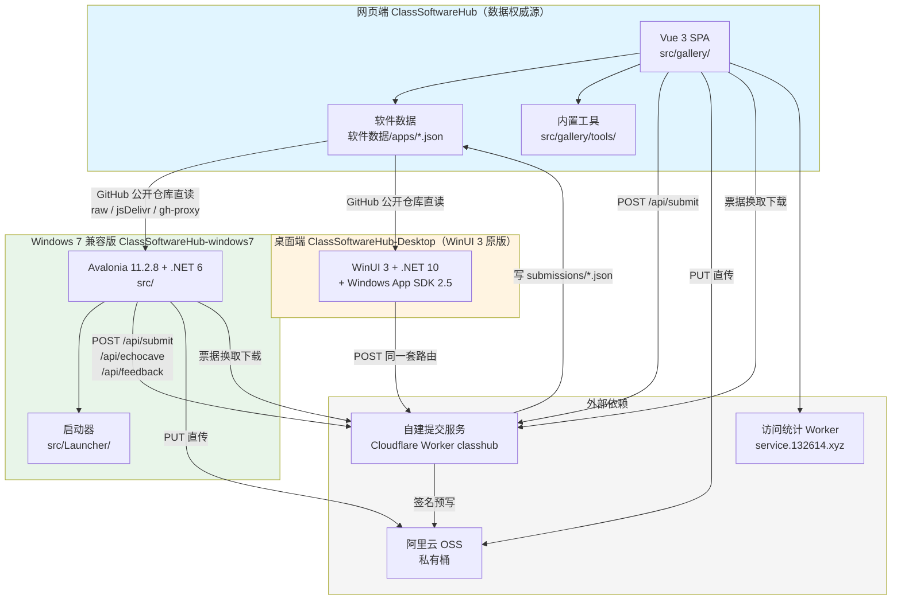

# ClassSoftwareHub 项目文档（网页端 · 桌面端 · Windows 7 兼容版）

## 文档说明

### 适用范围

| 项目 | 说明 |
| --- | --- |
| 适用仓库 | `c1201y/ClassSoftwareHub`（网页端）、`c1201y/ClassSoftwareHub-windows7`（Windows 7 兼容版）。`c1201y/ClassSoftwareHub-Desktop`（WinUI 3 原版桌面端）本地未定位到，本版文档基于网页端与 Windows 7 版仓库的实际代码撰写，并在相关章节标注该缺口。 |
| 适用平台 | 网页端：任意现代浏览器（含移动端）。Windows 7 兼容版：Windows 7 SP1 及以上（x64）。 |
| 目标读者 | 使用文档面向最终用户（电教委员）与机房管理员；开发文档面向参与本项目开发的工程师。 |
| 最后核对版本 | 网页端 `v2.3.4 - Tangram (20260927PR01)`（`package.json:3`、`文字设置.ts` 的 `app.version`）；Windows 7 兼容版 `ShellVersion = 1.2.0-insider1.0`（`src/Core/ShellConfig.cs:53`）。 |
| 许可证 | GPL-3.0（`LICENSE`）。 |

### 术语约定

| 术语 | 定义 |
| --- | --- |
| 网页端 | `ClassSoftwareHub` 仓库，Vue 3 + Vite + TypeScript 实现的纯静态站点，部署于 `https://classsoftwarehub.us.ci`。 |
| 桌面端（WinUI 3 原版） | `ClassSoftwareHub-Desktop` 仓库，基于 WinUI 3 + .NET 10 + Windows App SDK 2.5 的桌面客户端，系统底线为 Windows 10 1809。本版文档撰写时本地未定位到该仓库。 |
| Windows 7 兼容版 | `ClassSoftwareHub-windows7` 仓库（代号 `csh-win7`），以 Avalonia 11.2.8 + .NET 6 重写 UI 层的桌面客户端，系统底线为 Windows 7 SP1。 |
| 软件数据 | 网页端 `软件数据/apps/*.json` 中逐软件维护的结构化记录，是网页端与桌面端共用的唯一数据源。 |
| 提交服务 | 自建 Cloudflare Worker（代号 `classhub`），提供 `/api/submit`、`/api/echocave`、`/api/feedback`、`/api/oss-sign`、`/api/dl-ticket`、`/api/dl` 等路由。 |
| WinUIonWeb | 上游开源 WinUI 风格 Vue 组件库（Furry-Xiyi/WinUIonWeb），网页端 UI 的基础。 |

### 本地仓库定位结果

| 仓库 | 绝对路径 | git remote | 当前分支 | 当前提交 | 匹配依据 |
| --- | --- | --- | --- | --- | --- |
| `c1201y/ClassSoftwareHub-windows7` | `C:\csh-win7-repo` | `https://github.com/c1201y/ClassSoftwareHub-windows7.git` | `main` | `f447b77b52ab98a038892bb8116981758fd336a2` | `.git/config` 中 `remote "origin"` 精确匹配；`README.md`、`src/PORTING.md`、`BUILDING.md` 均声明为该仓库 |
| `c1201y/ClassSoftwareHub` | `C:\Users\Administrator\Documents\deepseek-harness\default-workspace\repo\ClassSoftwareHub-main` | 无（该副本不含 `.git` 目录，为源码快照） | 不适用 | 不适用 | `package.json` 的 `name` 为 `class-software-hub`、`description` 为「电教委员常用软件下载站」；`README.md` 徽章与正文指向 `c1201y/ClassSoftwareHub`；目录结构（`软件数据/`、`src/gallery/`、`文字设置.ts`）与仓库特征完全一致 |
| `c1201y/ClassSoftwareHub-Desktop` | 未定位到 | — | — | — | 已搜索当前工作目录及其父目录、`C:\Users\Administrator`（含 `Documents`、`Desktop`、`source`、`projects` 等常见位置）与 `C:\Users\Administrator\Documents\deepseek-harness\default-workspace\repo`，未发现匹配目录 |

**关于仓库名称的说明**：任务描述中给出的仓库标识为 `c201y/...`，而两个已定位仓库的 `git remote`、README 徽章与代码注释均一致指向 `c1201y/...`。本文档一律以代码中实际出现的 `c1201y` 为准。

**关于 `ClassSoftwareHub-Desktop` 的处置**：本地未定位到该仓库。本环境的 `pwsh` 工具不可用（所有命令均以 `exit 3221225794` 即 `0xC0000142 / STATUS_DLL_INIT_FAILED` 失败），无法执行兜底克隆。按任务规则第 10 条，本文档不依据仓库名称或远程平台页面推测该仓库内容；凡涉及 WinUI 3 原版桌面端的描述，均以 Windows 7 兼容版仓库中留存的移植对照记录（`src/PORTING.md`、`BUILDING.md`、`installer/ClassSoftwareHub-Win7.iss` 注释、`src/Core/ShellConfig.cs` 注释）为依据，并标注来源。需补充该仓库的本地路径或访问凭据后方可完善桌面端章节。

### 调研摘要

三个仓库属于同一产品的三种形态：网页端是唯一的**数据与内容权威源**，桌面端（WinUI 3 原版）与 Windows 7 兼容版是**外壳客户端**，均通过 GitHub 公开仓库直读网页端的软件数据，不自带内容包。

- **技术栈**：网页端为 Vue 3.5 + Vue Router 4（hash 路由）+ Vite 8 + TypeScript，纯静态、无后端；Windows 7 兼容版为 .NET 6（`net6.0-windows7.0`）+ Avalonia 11.2.8 + FluentAvaloniaUI 2.4.1，WebView2 SDK 锁定 `1.0.1587.40`。
- **入口**：网页端为 `index.html` → `src/main.ts` → `src/gallery/App.vue` → `src/gallery/router.ts`；Windows 7 兼容版为 `src/Program.cs`（`Main`）→ `src/App.axaml.cs`（单实例与生命周期）→ `src/MainWindow.axaml.cs`，便携版/安装版外层由 `src/Launcher/Program.cs` 启动。
- **构建方式**：网页端 `npm run build`（多文件，CI 部署）与 `npm run build:single`（单文件，离线）；Windows 7 兼容版 `dotnet publish`（应用本体）+ `dotnet publish`（启动器）+ `tools/pack-win7-portable.ps1`（组装）+ Inno Setup 6（安装包），发版走 `dv*` tag 触发 `.github/workflows/win7-release.yml`。
- **已确认项**：三仓数据流关系、网页端 8 条路由与 11 个内置工具、Windows 7 版的版本号规则与更新双通道、Inno Setup 安装脚本的系统门槛与 WebView2 提示逻辑、日志与缓存的目录结构、提交服务三条路由与 OSS 直传/票据下载协议、age 公钥加密联系方式、CI/CD 五个工作流的职责分工。
- **待确认项**：`ClassSoftwareHub-Desktop` 仓库的全部实现细节（主进程/渲染进程划分、IPC、自动更新、打包与签名）；提交服务 Worker 的源码（`AGENTS.md:77-79` 明确其不在仓库内）；网页端 `stats-worker` 源码（同样不在仓库内）。

---

# 使用文档

## 项目概述

### 项目简介

ClassSoftwareHub 是一个面向电教委员（负责教室电脑与电教设备管理的人员）的常用软件下载站，收录系统工具、教学软件、教学辅助与其他工具四类常用软件，提供版本号、体积、系统限制与校验值，并给出文件直链。站点刻意保持「无广告、无捆绑、开源优先」的收录倾向（`AGENTS.md:5-6`）。

除软件下载外，站点内置 11 个纯本地运行的课堂工具（随机抽号、课堂计时、全屏时钟、编码与哈希、Markdown 预览、二维码生成、时间戳转换、系统镜像下载入口等），并提供全站搜索、AI 导航与反馈中心。

### 三种形态的区别与关系

| 形态 | 仓库 | 技术形态 | 系统要求 | 数据来源 |
| --- | --- | --- | --- | --- |
| 网页端 | `ClassSoftwareHub` | 静态站点（Vue 3 SPA） | 任意现代浏览器 | 仓库内 `软件数据/apps/*.json`（权威源） |
| 桌面端（WinUI 3 原版） | `ClassSoftwareHub-Desktop` | WinUI 3 + .NET 10 + Windows App SDK 2.5 | Windows 10 1809 及以上 | 从 `ClassSoftwareHub` 仓库同步 |
| Windows 7 兼容版 | `ClassSoftwareHub-windows7` | Avalonia 11.2.8 + .NET 6 | Windows 7 SP1 及以上（x64） | 从 `ClassSoftwareHub` 仓库同步 |

三者的关系如下：

1. **数据同源**。网页端仓库的 `软件数据/apps/*.json` 是唯一权威数据。两个桌面端安装包均不自带内容包，首次启动必须联网，从 GitHub 公开仓库直读该目录（`src/Core/ShellConfig.cs:154-163`、`src/Services/GithubContentSync.cs:19-33`）。
2. **更新通道隔离**。Windows 7 兼容版与 WinUI 3 原版各自独立发布、各自独立更新，互不接收对方的版本（`README.md:27`、`src/Core/ShellConfig.cs:76-82`）。
3. **可同机共存**。Windows 7 兼容版与 WinUI 3 原版的安装目录（`...\Programs\ClassSoftwareHub-Win7`）与 Inno Setup 的 `AppId` 均不同，可在同一台机器上并存（`BUILDING.md:69`、`installer/ClassSoftwareHub-Win7.iss:10-17`）。
4. **功能对齐**。Windows 7 兼容版以「语义等价、UI 1:1」为移植契约，布局、间距、圆角、颜色、图标码位与文案均与原版对齐（`src/PORTING.md:15-24`）。

### 适用场景

- **教室机批量装机**：机房管理员通过网页端挑选无捆绑的常用软件，批量下载。
- **老旧机器使用桌面客户端**：硬件或系统无法升级至 Windows 10 的教室机，使用 Windows 7 兼容版获得与网页端一致的软件清单与工具。
- **课堂现场工具**：随机抽号、计时、全屏时钟、截屏贴图等课堂高频操作，桌面端提供浮窗与侧边栏形态，不遮挡讲课内容。

## 网页端使用说明

### 访问方式

| 入口 | 地址 |
| --- | --- |
| 主站 | `https://classsoftwarehub.us.ci` |
| 备用站点 | `https://classsoftwarehub.132614.xyz` |

备用站点的服务速度通常更快，但福建闽北、闽西地区用户可能遇到无法打开的情况（`CHANGELOG.md:29-30`）。站点同时提供 GitHub Pages 与 FTP 镜像，以及 OpenList 网盘副本（`AGENTS.md:23`）。

网页端为纯静态站点，无需注册账号即可浏览与下载。单文件版本（`dist/index.html`，约 2 MB）可离线双击打开，功能与在线版一致（`README.md:49`）。

### 登录与账号

网页端**不提供账号体系**，无登录环节。涉及身份的功能通过以下方式实现：

1. **提交软件、回声洞投稿、反馈中心**：填写内容后直接提交，无需 GitHub 账号；提交记录进入仓库的审核队列，由维护者在 GitHub Issue 上处理（`AGENTS.md:296-299`）。
2. **联系方式加密**：「提交软件」与「反馈中心」的联系方式字段在浏览器本地用 age 公钥加密后再提交，公开记录中仅为密文，仅维护者可用私钥解密（`CHANGELOG.md:23`、`src/gallery/ossDownload.ts` 同源的 `deviceFingerprint.ts`）。

### 主要功能

| 功能 | 说明 |
| --- | --- |
| 软件浏览 | 首页按分类（系统工具 / 教学软件 / 教学辅助 / 其他工具）展示软件卡片，含图标、名称、一句话简介 |
| 软件详情 | 详情页展示详细介绍、版本号、体积、系统限制、官方网站与 GitHub 仓库，以及逐平台的下载项与校验值 |
| 下载 | 文件直链项点击后在本页直接开始下载；官网下载页项在新标签页打开；网盘项跳转分享页 |
| 校验值 | 详情页显示校验值首尾各几位，悬停可查看完整值，点击即可复制 |
| 加速下载 | 识别为 GitHub 文件链接的下载项旁显示「加速下载」按钮，展开镜像通道列表；官方链接与非 GitHub 主机不显示该按钮 |
| 全站搜索 | `Ctrl + K` 或 `Ctrl + F` 唤出搜索面板，一次搜索软件、内置工具、AI 导航站点与页面，`↑` `↓` 选择、`Enter` 打开、`Esc` 关闭 |
| 内置工具 | 11 个纯本地工具，见下方清单 |
| AI 导航 | 21 个国产 AI 网站的整行可点导航 |
| 欢迎弹窗 | 首次访问落在首页时弹出一次，提供仓库地址、作者主页、相关文章、QQ 群、投喂作者五个外链 |
| 回声洞 | 设置页可展开，逐条显示群友投稿并逐字打出 |

**内置工具清单**（`src/gallery/tools/index.ts`）：

| 分组 | 工具 |
| --- | --- |
| 图片与颜色 | 图片取色、颜色转换 / 配色 |
| 课堂 | 随机抽号、课堂计时器、全屏时钟 |
| 文本与编码 | 文本处理、编码 / 哈希工具、Markdown 预览 |
| 实用工具 | 二维码生成、时间戳转换、系统镜像下载 |

### 典型操作流程

**下载一个软件**：

1. 打开站点，首页按分类浏览，或在搜索面板输入软件名称。
2. 点击卡片进入详情页（地址形如 `#/download/7-zip`）。
3. 核对版本号、系统限制与体积。
4. 在下载区选择对应平台的条目：
   - 按钮文字为「下载」→ 本页直接开始下载；
   - 按钮文字为「前往官网」→ 新标签页打开厂商下载页；
   - 按钮文字为「前往网盘」→ 新标签页打开分享页。
5. 如需校验完整性，点击校验值复制完整哈希，与下载到的文件自行比对。

**使用课堂抽号工具**：

1. 通过搜索面板或底部导航进入「内置工具」，选择「随机抽号」。
2. 输入号码范围（例如学号 1~50）。
3. 按需设置一次抽取数量、是否抽过不重复、是否按号码随机分组。
4. 开始抽取。

**提交一个软件**：

1. 进入「提交软件」页（`#/submit`）。
2. 可直接填写，或使用「从 GitHub 一键读取」自动填充仓库信息。
3. 填写必填项：`id`、`name`、`category`、`tagline`、`description`、`system`、联系方式，以及至少一条文件直链。
4. 可选填写校验值，支持带 `MD5:` 前缀或按字节分隔的写法。
5. 提交后进入审核队列；维护者在 Issue 上标注 `approved` 后合并发布。

### 权限说明

| 角色 | 可执行的操作 |
| --- | --- |
| 访客 | 浏览、搜索、下载、使用全部内置工具、提交软件、回声洞投稿、提交反馈 |
| 维护者 | 合并或驳回提交（在 GitHub Issue 打标签）、编辑软件数据与站点文字、修改 CI 配置 |

网页端不存在服务端鉴权；所有「提交」本质是向公开仓库写入草稿文件或创建 Issue。

### 常见问题

| 现象 | 原因 | 处理方式 |
| --- | --- | --- |
| 页面顶部出现红色提示条 | 某个软件 JSON 格式错误 | 该文件被跳过，其余软件正常显示。将提示中的文件名与行号反馈给维护者修正 |
| 详情页显示「未找到该软件」 | 历史数据中有 5 个 `id` 混入了 `?` `&` `=` 等参数符号 | 该问题已修复；如仍出现，请反馈具体地址 |
| 点击「下载」没有反应 | 下载项是官网下载页或网盘，按钮文字分别为「前往官网」「前往网盘」，需在新标签页中继续操作 | 查看按钮文字与说明 |
| 图标显示为首字母占位 | 该软件 `icon` 为空或图片加载失败 | 不影响下载；可向维护者反馈补充图标 |
| 备用站打不开 | 区域性网络问题 | 改用主站 |
| 商店链接点击后要求先安装商店 | 本机未安装 Microsoft Store（LTSC / 精简版 / 被卸载过） | 按 `Win + R` 输入 `wsreset -i` 让 Windows 联网装回商店；备用命令 `winget install 9WZDNCRFJBMP` |

## 桌面端使用说明

> 本章同时适用于 WinUI 3 原版与 Windows 7 兼容版；两者在功能与交互上保持一致，差异集中在安装前提与系统要求，详见「Windows 7 版本使用说明」。本章命令与路径均来自 Windows 7 兼容版仓库，原版桌面端的对应实现细节因本地未定位到仓库而标注为待确认。

### 安装

**安装版**：

1. 从发布页下载 `ClassSoftwareHub-Setup-win7-dv<版本>.exe`。
2. 双击运行。安装前若检测到应用正在运行，安装程序会先礼貌关闭（`taskkill`），不退再强杀；应用无未保存状态、设置即时落盘，被杀不丢数据（`installer/ClassSoftwareHub-Win7.iss:138-166`）。
3. 按向导完成安装，可选创建桌面快捷方式。
4. 安装完成自动拉起应用（`installer/ClassSoftwareHub-Win7.iss:96-98`）。

**便携版**：

1. 从发布页下载 `ClassSoftwareHub-Portable-win7-dv<版本>.zip`。
2. 解压到任意位置（U 盘亦可）。
3. 双击根目录的 `ClassSoftwareHub.exe` 启动。
4. ⚠️ `app` 文件夹必须与启动器放在一起，单独拿走 exe 无法启动（`tools/pack-win7-portable.ps1:89-91`）。

每个安装包均附带同名 `.md5` 文件，下载后可校验完整性（`README.md:52`）。

### 首次启动

1. 启动后进入欢迎页，展示站点简介与快速入口。
2. **首次启动必须联网**：安装包不自带内容包，软件清单需从 GitHub 仓库同步；未取到时界面显示「尚未获取到内容」并给出重试入口（`src/Core/ContentStore.cs:16-19`）。
3. 同步完成后即可浏览软件、使用工具。

### 登录

桌面端**无账号登录**。所有需要身份的操作（提交软件、回声洞投稿、反馈中心）均为匿名提交，由维护者在后台处理。

### 主要功能

| 功能 | 说明 |
| --- | --- |
| 软件下载 | 与网页端一致的分类浏览、详情查看、下载与校验值；清单跟随网站数据自动更新 |
| 全站搜索 | 一次搜索软件、内置工具与页面 |
| 常用工具浮窗 | 随机摇号、课表计时、秒表计时、全屏时钟等，可拖边缩放，可置顶 |
| 工具侧边栏 | 可自行拼装：把常用工具拖入侧边栏、排序、拖出删除；支持贴靠（左右两边）与自由（四条边）两种模式 |
| 截屏贴图 | 拖拽框选屏幕区域后进入编辑（画笔 / 荧光笔 / 箭头 / 矩形 / 椭圆 / 文字 / 马赛克），支持撤销重做、复制、存盘与钉图 |
| 外观 | 主界面与外部小窗可分别使用浅色 / 深色；背景支持亚克力 / 云母 / 纯色 |
| 自动更新 | 内置双通道更新器（正式版 / 预览版），自动核对版本、下载并校验安装包 |
| 更新日志 | 站内直接查看历史版本说明 |
| 数据容错 | 单条数据异常不影响整站，页面顶部给出明确提示 |

### 数据存储位置

| 内容 | 位置 |
| --- | --- |
| 设置、缓存、内容（数据根目录） | `%LOCALAPPDATA%\ClassSoftwareHub\` |
| 同步下来的软件数据 | `%LOCALAPPDATA%\ClassSoftwareHub\content\` |
| 日志 | `%LOCALAPPDATA%\ClassSoftwareHub\logs\{启动时间}\`，每次启动一个目录，内含 `app.log` 与 `crash.log` |
| WebView2 用户数据 | `%LOCALAPPDATA%\ClassSoftwareHub\WebView2\` |
| 便携版排障日志 | 便携版目录旁的 `port.log` |

数据根目录由 `AppPaths.DataDir` 定义（`src/Core/ShellConfig.cs:249-254`）；日志目录结构见 `src/Services/LogHome.cs:22-25`。

### 更新

1. 在设置页选择更新通道：正式版（stable）或预览版（insider）。
2. 点击「检查更新」。客户端读取**本版本自己的仓库** Release：正式版取非预发布的最新 Release，预览版取预发布及非预发布（`src/Core/ShellConfig.cs:73-82`）。
3. 发现新版本后下载安装包，**校验通过后方可安装**。发布包均附带 `.md5` 资产，由发版脚本生成上传；若发布方未提供任何可用校验值，更新会中止而不执行未校验的安装包（`src/Services/Updating/UpdateService.cs:39-49`）。
4. 安装过程为静默安装（`/SP- /SILENT`），许可页会被跳过并视为已接受，升级流程不被打断（`installer/ClassSoftwareHub-Win7.iss:68-69`）。
5. 安装版采用「启动器 + `app\` 子目录」两层结构，更新只替换 `app\` 子目录，启动器与桌面快捷方式路径永远有效（`BUILDING.md:22-32`）。

**回滚**：设置页可查看历史版本列表（正式版通道只列正式版，预览版通道同时列出预览版），选择任意版本安装，不回校验版本高低（`src/Services/Updating/UpdateService.cs:128-148`）。

**便携版更新**：便携版不会自动替换自己（正在运行的程序无法覆盖自身）。有新版本时，请到发布页下载新的便携包，解压后**替换整个 `app` 文件夹**；存放在 `%LOCALAPPDATA%\ClassSoftwareHub` 的设置不会丢失（`tools/pack-win7-portable.ps1:92-96`）。

### 卸载

**安装版**：通过「设置 → 应用 → 已安装的应用」或控制面板的卸载项执行。卸载项显示名形如 `ClassSoftwareHub dv<版本> (Windows 7)`。卸载不会删除 `%LOCALAPPDATA%\ClassSoftwareHub` 中的设置、缓存与日志；如需彻底清除，请手动删除该目录。

**便携版**：直接删除解压目录即可。该形态不写注册表（`README.md:48`）。

### 故障排查

| 现象 | 原因 | 处理方式 |
| --- | --- | --- |
| 双击桌面图标无反应，多次点击仍无界面 | 关闭窗口默认是收进托盘，进程未退出；第二个实例被单实例互斥体拦下 | 已修复：第二个实例会通过命名事件唤醒第一个实例并显示主窗口。若仍无反应，查看托盘区（含溢出区）是否有应用图标 |
| 进程留在任务管理器中，托盘菜单「退出」无效 | 工具浮窗等窗口拦截了关闭事件 | 已通过「应用正在退出」全局标记修复；如复现，请在任务管理器结束进程并反馈 |
| 软件列表为空，提示「尚未获取到内容」 | 首次启动未联网，或 GitHub 访问不通 | 连接网络后点击重试；若持续失败，检查网络能否访问 `github.com` |
| 详情页内打开官网无反应 | 未安装 WebView2 运行时 | 安装 WebView2 运行时；Windows 7 上最高仅支持 109.x 版本 |
| 界面出现随机灰矩形残影 | Windows 7 老显卡表面保帧不可靠 | Windows 7 上默认已启用软件渲染；如仍出现，尝试加 `--software-render` 参数启动 |
| 主界面无法显示 | 极少数老显卡 D3D11 与 OpenGL 均不可用 | 以 `--software-render` 参数启动；或使用 `--takeover` 结束异常实例 |
| 界面点不动或托盘无图标 | 走了非预期的系统版本分支 | 便携版目录旁的 `port.log` 与 `%LOCALAPPDATA%\ClassSoftwareHub\logs\` 下的日志可定位；反馈时请附带 |

## Windows 7 版本使用说明

### 安装前提

| 项目 | 要求 |
| --- | --- |
| 操作系统 | Windows 7 **SP1** 及以上（.NET 6 在 Windows 7 上要求 SP1，这是硬门槛） |
| 架构 | x64（安装脚本限制 `ArchitecturesAllowed=x64compatible`） |
| .NET 运行时 | **无需单独安装**。应用为自包含（self-contained）发布，目标机不需另装 .NET |
| WebView2 运行时 | 可选。仅「应用内网页浮层」需要；未安装时主要功能不受影响，对应场景会降级为「用浏览器打开」 |
| 磁盘空间 | 安装版默认装入 `%LOCALAPPDATA%\Programs\ClassSoftwareHub-Win7`，所需空间以安装包体积为参考 |

安装程序在 `InitializeSetup` 阶段执行两项检查：

1. **系统版本检查**：低于 Windows 7 SP1 时拒绝安装，并提示安装 SP1 或改用网页版，提供「打开网页版」按钮（`installer/ClassSoftwareHub-Win7.iss:194-264`）。
2. **WebView2 运行时检查**：未检测到时仅提示，不自动下载。原因是 Windows 7 上 WebView2 运行时止于 109.x，官方 bootstrapper 拉取的是更新版本、装了也无法使用；自动安装反而造成「装完了还是不行」的困惑（`installer/ClassSoftwareHub-Win7.iss:100-108`、`266-278`）。

### 运行环境

- **渲染**：Windows 7 上默认直接走软件渲染（帧缓冲在进程内存中），从根本上避免老显卡表面保帧不可靠导致的残影。代价是界面稍慢，但对「大部分时间静止」的界面开销可接受；WebView2 为独立进程渲染，不受影响（`src/Program.cs:70-82`）。
- **视觉效果降级链**：Windows 7 无 Mica / 亚克力 / 深色标题栏 / 窗口圆角，`Platform.Backdrop` 会自动分级降级到 Aero 毛玻璃或纯色（`src/PORTING.md:193-195`）。DWM 合成被关闭（经典 / 基本主题）时一律退回纯色底，不留透明（`src/Platform/OsInfo.cs:57-73`）。
- **图标字体**：Windows 7 无 Segoe MDL2 Assets / Segoe Fluent Icons，已改用内嵌字体 `CshSymbols`（MDL2 码位重映射）（`src/PORTING.md:196-197`）。
- **截屏**：Windows 7 无 `Windows.Graphics.Capture`，截屏走 GDI `BitBlt`（`src/PORTING.md:198-200`）。

### 功能差异

Windows 7 兼容版与 WinUI 3 原版在功能上保持一致，差异集中在视觉与系统集成层面：

| 项目 | WinUI 3 原版 | Windows 7 兼容版 |
| --- | --- | --- |
| 系统底线 | Windows 10 1809 | Windows 7 SP1 |
| UI 框架 | WinUI 3 | Avalonia 11.2.8 + FluentAvaloniaUI 2.4.1 |
| 背景材质 | Mica / 亚克力 | Aero 毛玻璃或纯色（按 DWM 合成状态降级） |
| 标题栏 | 可扩展客户区 + 深色标题栏 | 保留系统边框，更稳 |
| 图标字体 | Segoe MDL2 Assets | 内嵌 `CshSymbols` |
| 截屏 | `Windows.Graphics.Capture` | GDI `BitBlt` |
| WebView2 | 运行时版本不受限 | 运行时止于 109.0.1518.x，SDK 锁定 `1.0.1587.40` |
| 启动加速 | JIT | ReadyToRun 预编译（本机实测启动 6.4s → 显著缩短，代价为体积约 +30%） |

### 已知限制

1. **WebView2 运行时上限**：Windows 7 上最高仅支持 109.0.1518.x，无法使用更新的 WebView2 特性。应用内网页浮层在运行时不可用时降级为「用浏览器打开」（`src/PORTING.md:198-200`、`src/Services/WebViewRuntimeService.cs:10-18`）。
2. **C# 语言版本锁定为 10**：.NET 6 SDK 的上限，不能使用 C# 11/12 的 `required`、原始字符串、列表模式、集合表达式、主构造函数（`src/PORTING.md:202-203`）。
3. **Avalonia 控件差异**：Avalonia 无 `VariableSizedWrapGrid`、`RelativePanel`、`ItemsRepeater`，需以 `WrapPanel`、`Grid`、`ItemsControl` 等价还原（`src/PORTING.md:101-104`）。
4. **软件渲染下的性能**：动画密集场景帧率低于 GPU 渲染路径。
5. **3 个低置信度图标映射**：`U+E840`、`U+EEA1`、`U+EEA3` 三个码位可能渲染为空白或方块（`src/PORTING.md:159-160`）。

### 升级建议

| 场景 | 建议 |
| --- | --- |
| 教室机可升级至 Windows 10 1809 及以上 | 可改用 WinUI 3 原版桌面端，获得 Mica / 亚克力等视觉效果与 GPU 渲染 |
| 教室机必须留在 Windows 7 | 继续使用本版本；保持 SP1 已安装，并注意 WebView2 运行时最高只能装 109.x |
| 无桌面端需求 | 直接使用网页端，功能一致，且不受系统版本限制 |
| 同机混用 | Windows 7 兼容版与 WinUI 3 原版安装目录与 AppId 不同，可同机共存，互不覆盖 |

## 管理员指南

> 本章面向站点维护者与机房管理员。「维护者」指拥有仓库写权限的人员。

### 账号与权限

| 系统 | 权限模型 |
| --- | --- |
| GitHub 仓库 | 公开仓库；写权限由维护者持有。所有凭据通过仓库 Secrets（`FTP_*`、`WEBDAV_*`、`GITHUB_TOKEN`）注入，**任何凭据不得明文写入仓库任何文件（含注释）** —— 公开仓库中写入即公开，且进入 git 历史后无法撤回，只能更换凭据（`AGENTS.md:124-126`） |
| 提交服务 Worker | 客户端只发内容，GitHub 令牌在服务端；三条提交路径均无需登录 GitHub（`src/Services/SubmitClient.cs:14-17`） |
| 反馈标签 | 六个标签 `用户反馈`、`报告问题`、`提出建议`、`逻辑交互`、`链接失效`、`其他问题` 为**一次性手工创建**；细粒度 PAT 无法通过 API 创建（`POST /labels` 返回 403），故无法自动化（`AGENTS.md:386-392`） |
| Issue 操作授权 | 体检 Issue 由机器人创建，因此只有拥有写权限的用户才能编辑其正文，无需额外鉴权门（`AGENTS.md:624-625`） |

### 配置管理

**站点文字**：中文站唯一需要修改的文件是仓库根目录 `文字设置.ts`，只改引号内的值，**不得改左侧键名**（键名是页面查找文案的依据，改错会导致文字消失）。英文站同步修改 `src/gallery/Strings/en-US/Resources.ts`（`AGENTS.md:109-111`）。

**AI 导航**：根目录 `AI导航文本.ts`，每个网站一段配置。

**软件数据**：只修改 `软件数据/apps/*.json`，**不得修改** `src/gallery/data/index.ts`（那是加载器）（`AGENTS.md:112-113`）。

**分类**：`软件数据/categories.json` 含 4 个分类（`system` / `schedule` / `teaching` / `other`）。

**桌面端常量**：Windows 7 兼容版的外壳常量集中在 `src/Core/ShellConfig.cs`，包括站点地址、版本号、更新仓库、提交入口、内容清单地址等。发版时主要修改 `ShellVersion` 与 `SiteVersionTarget` / `SiteVersionDisplay`。

### 数据维护

**软件数据字段**（完整参考 `软件数据/README-维护手册.md` 与 `_模板.json`）：

| 字段 | 含义 | 约束 |
| --- | --- | --- |
| `id` | 唯一英文标识，网址为 `#/download/<id>` | 仅允许英文小写、数字与短横线；不得包含 `?` `&` `=` |
| `name` | 软件名称 | 无限制 |
| `icon` | 图标图片链接 | 建议正方形 256×256；留空显示占位 |
| `category` | 所属分类 | 必须是 `categories.json` 中的 key |
| `tagline` | 一句话简介 | 首页卡片 |
| `description` | 详细介绍 | 详情页 |
| `version` `size` `system` | 版本号 / 体积 / 系统限制 | — |
| `website` `github` | 官方网站 / 仓库 | `github` 必须是真仓库地址，非 GitHub 分发软件不填 |
| `notice` | 更新提示 | 可选；详情页下载区上方蓝色提示条 |
| `store` | 商店链接 | 可选；`downloads` 中任一 `url` 指向 `apps.microsoft.com` 也会自动识别为商店卡片 |
| `downloads[]` | 下载项数组 | 见下 |
| `sort` | 显示顺序 | 数值越小越靠前，省略表示最后 |
| `维护备注` | 维护者备注 | 网页不显示 |

**下载项格式**：

```json
{
  "platform": "Windows x64 安装版",
  "note": "官方安装包，GitHub 链接有时不稳定",
  "size": "373 KB",
  "kind": "file",
  "hash": "3F7A9C1D…",
  "url": "https://github.com/xxx/xxx/releases/download/xxx.exe"
}
```

`kind` 决定按钮文案与行为：`file` → 「下载」（本页直接下载）；`page` → 「前往官网」（新标签页）；`netdisk` → 「前往网盘」（新标签页）；`store` → 并入商店卡片。不写时按网址自动判断。

`hash` 只填十六进制串，算法按长度自动识别（32 = MD5、40 = SHA-1、56 = SHA-224、64 = SHA-256、96 = SHA-384、128 = SHA-512）。不得将校验值整串写入 `note`（128 位无可断行处，会导致文字溢出卡片）。

**新增软件登记位置**：决定它以后如何跟随上游更新。

| 软件情况 | 操作 | 由谁跟踪 |
| --- | --- | --- |
| 有 GitHub 仓库 | JSON 填 `github` 字段 | `scripts/check-updates.mjs`，每周读 Releases |
| 无仓库，官网有固定直链 | `scripts/resolve-direct-links.mjs` 的 `RESOLVERS` 加一条 | `resolve-direct-links.mjs`，每周刷新直链与版本号 |
| 无仓库，直链带版本号或藏在页面里 | 同上，用 `probe` 或 `rewrite` | 同上 |
| 确实拿不到 | `scripts/untracked-buckets.mjs` 的 `BUCKETS` 加一条并写明理由 | 无人跟踪，但报告会如实标注原因 |

**处理他人提交的草稿**：草稿工单标题带 `[待审核]`，在 Issue 上打标签处理。

| 标签 | 效果 |
| --- | --- |
| `approved` | 合并为 `apps/<id>.json`。**若站内已有同 id 文件，直接拒绝并说明**，防止误覆盖 |
| `覆盖已存在` | 整份替换站内文件。机器人将「改前 → 改后」差异与旧版完整内容贴进 Issue；旧版可从 `git show <父提交>:软件数据/apps/<id>.json` 找回 |
| `rejected` | 删除草稿并关闭工单 |

草稿中 `_` 开头的键（如 `_联系方式`、`_提交时间`）为审核专用字段，合并时全部剥除，不会发布到网站。

**图标本地化**：图标挂在 GitHub / jsDelivr 等国内不稳定域名、或体积偏大时，执行 `python scripts/icon-sync.py --apply --only <软件id>`，生成 64×64、≤ 4 KB 的 `src/assets/icons/<id>.webp`，会被 Vite 内联进产物。

### 版本自动核对

站点**每周五上午**自动核对每个软件的版本号、下载直链与体积，来源有两条：GitHub Releases（`scripts/check-updates.mjs`）与官方下载源（`scripts/resolve-direct-links.mjs`，覆盖微信、QQ、WPS、腾讯会议、Chrome、火绒、VLC、希沃系列等 21 款）。

判定原则为**全有或全无**：版本号与下载直链是一个整体，只要有一处无法处理就不做任何修改，否则会出现「版本号已更新、直链仍指向旧文件」的矛盾数据。

脚本无法确定的条目汇总为「软件信息体检 · 待人工确认」Issue，每条提供三个复选框：

| 处理意图 | 操作 | 效果 |
| --- | --- | --- |
| 已在别处改完，需重新检测 | 修改并**提交**后勾选「已改好 → 重新检测」 | 重新执行完整检查，正确则该项消失 |
| 本次暂不处理 | 勾选「本次跳过」 | 仅压制当前这一版问题；上游发布新版或直链更换后自动恢复提醒 |
| 今后不再提醒 | 勾选「不用跟进」 | 永久静音；评论 `/ignore 软件id` 等效 |

**必须先提交再点重新检测**，否则系统读到的仍是旧数据。三个复选框均为一次性操作，不是待办项。

命令行用法：

```bash
# 仅检查，不修改任何文件
node scripts/check-updates.mjs --report=报告.md --pending=待审.md
# 检查并写回可确定的信息
node scripts/check-updates.mjs --apply --report=报告.md --pending=待审.md
# 非 GitHub 应用的直链解析（只读）
node scripts/resolve-direct-links.mjs --report=解析报告.md
# 查看已永久忽略的软件
node scripts/update-ignore.mjs --list
```

建议配置 GitHub 令牌（匿名接口限流 60 次/小时）：

```bash
export GITHUB_TOKEN=xxx        # Linux / macOS
set GITHUB_TOKEN=xxx           # Windows CMD
```

### 日志查看

**站点**：静态站点无服务端日志。站点自身的访问统计由自建 Cloudflare Worker 提供（`/api/hit` 上报、`/api/stats` 只读查询），其源码不在仓库内。

**桌面端**：

1. 打开设置页的「日志」区。
2. 日志按「启动一次一个目录」组织，目录名即启动时间（形如 `logs\2026-10-11_00-13-41\`）。
3. 每个目录含两个文件：`app.log`（日常全部日志）与 `crash.log`（崩溃与页面加载失败）。
4. 行格式为 `[时间] [级别] [模块] 消息`，支持按级别与模块筛选。
5. 用户反馈问题时，通常只需提供 `crash.log`。

日志目录也可直接在文件管理器中打开：`%LOCALAPPDATA%\ClassSoftwareHub\logs\`。

### 备份与恢复

| 对象 | 备份方式 | 恢复方式 |
| --- | --- | --- |
| 软件数据 | 已在 git 版本控制中，通过提交历史回溯 | `git show <父提交>:软件数据/apps/<id>.json` 可找回任一历史版本 |
| 站点文字 | 同上 | 同上 |
| 桌面端用户设置 | 复制 `%LOCALAPPDATA%\ClassSoftwareHub\` 目录 | 粘贴回原路径 |
| 桌面端内容缓存 | 删除后重启可重新同步，无需专门备份 | — |
| 桌面端日志 | 复制 `%LOCALAPPDATA%\ClassSoftwareHub\logs\` | — |

---

# 开发文档

## 总体架构与仓库关系

### 职责划分



### 依赖关系

1. **数据流向**：网页端仓库的 `软件数据/apps/*.json` 是唯一权威源。桌面端安装包**不自带内容包**，首次启动必须联网，通过 GitHub 公开仓库直读该目录（`src/Core/ShellConfig.cs:154-163`、`src/Services/GithubContentSync.cs:19-33`）。此项设计于上游 2026-10-05 定案，原因是装机残留会让已下架的软件「删了又复活」，且自带的 `text/` 写进缓存后再也不更新（`src/Core/ShellConfig.cs:232-235`）。
2. **提交回流**：访客通过网页端或桌面端提交软件 / 回声洞 / 反馈，写入 `submissions/*.json`，经 GitHub Actions 转为 Issue，维护者打标签后由 `review-submission.yml` 合并回 `软件数据/apps/<id>.json` 或 `回声洞/messages/`。
3. **发布隔离**：Windows 7 兼容版与 WinUI 3 原版各自独立发布、各自独立更新。Win7 版的「检查更新」与「更新日志」只读本仓库的 Release（`README.md:27`、`src/Core/ShellConfig.cs:76-82`）。

### 部署形态

| 形态 | 产物 | 部署目标 |
| --- | --- | --- |
| 网页端 | `dist/`（`index.html` + `assets/`，约 72 个文件） | GitHub Pages、FTP、OpenList WebDAV 三路并行 |
| 网页端单文件 | `dist/index.html`（约 2 MB） | 离线双击，**线上不使用** |
| Windows 7 兼容版便携版 | `ClassSoftwareHub-Portable-win7-dv<版本>.zip` | 用户自行下载解压 |
| Windows 7 兼容版安装版 | `ClassSoftwareHub-Setup-win7-dv<版本>.exe` | Inno Setup 6 编译 |

`deploy.yml` 只构建一次，产物由三个上传任务共用；Pages 原样发布、FTP 镜像（并删除远端已不存在的文件）、OpenList 原样上传（不压缩）并清理构建产生的 `assets/` 层。`vite.config.ts` 设置 `base: './'`，使同一份产物同时适配根目录与子目录两种形态；hash 路由保证文档路径不变（`AGENTS.md:496-501`）。

## 技术栈与目录结构

### 网页端（ClassSoftwareHub）

**技术栈**：Vue 3.5 + Vue Router 4（hash 路由）+ Vite 8 + TypeScript ~6.0；UI 组件库 WinUIonWeb（上游源码内置于 `src/components`、`src/styles`、`src/utils`）；无后端（`package.json:17-35`、`AGENTS.md:18`）。

**Node 版本要求**：`^20.19.0 || >=22.12.0`（`package.json:36-38`）。

```
ClassSoftwareHub/
├── 文字设置.ts                ★ 中文 UI 文案唯一修改点
├── 鸣谢文本.ts                 设置页致谢列表
├── AI导航文本.ts               AI 导航站点配置
├── index.html                 入口 HTML（异步注入百度统计）
├── vite.config.ts             base:'./'、ASCII chunk 名、dev 轮询
├── package.json               脚本与依赖
├── 软件数据/
│   ├── apps/*.json            一软件一文件（当前 71 款 + _模板.json）
│   ├── categories.json        4 个分类
│   ├── update-ignore.json     更新检查的忽略与跳过记录
│   └── README-维护手册.md      ★ 数据维护手册
├── 回声洞/messages/*.json     构建期 import.meta.glob 收集
├── submissions/               访客提交草稿（勿手工编辑）
├── public/                    robots.txt · sitemap.xml · favicon.ico 等
├── scripts/                   维护脚本（见附录脚本清单）
├── src/
│   ├── main.ts                挂载入口
│   ├── gallery/               ★ 本站应用代码（唯一应改动代码的位置）
│   │   ├── App.vue           外壳：导航窗格 / 主题 / 节日皮肤 / 欢迎弹窗 / 数据错误条
│   │   ├── router.ts         8 条路由
│   │   ├── pages/            HomePage / DownloadDetailPage / SettingsPage /
│   │   │                     SubmitPage / FeedbackPage / AiNavPage / EchoCavePage
│   │   ├── tools/            ★ 内置工具：index.ts 注册表 + ToolShell.vue + 一工具一 .vue
│   │   ├── data/index.ts     数据加载器（容错解析，勿改）
│   │   ├── appIcons.ts       图标解析：优先本地 64px，回退 icon URL
│   │   ├── searchIndex.ts    全站搜索索引
│   │   ├── GlobalSearch.vue  Ctrl+K 搜索面板
│   │   ├── feedback.ts       反馈中心纯逻辑（无 Vue 依赖）
│   │   ├── githubImport.ts   从 GitHub 一键读取
│   │   ├── githubMirror.ts   加速下载镜像通道
│   │   ├── ossUpload.ts      OSS 直传
│   │   ├── ossDownload.ts    票据换下载
│   │   ├── deviceFingerprint.ts  设备指纹
│   │   ├── submitEndpoints.ts    提交入口排序与记忆
│   │   ├── visitor.ts        自建访问统计 + 百度统计 SPA 回放
│   │   ├── holidayTheme.ts   节日皮肤
│   │   ├── Strings/en-US/    英文站文案
│   │   └── styles/           首页 / 详情页样式
│   ├── components/ styles/ utils/ assets/   ⛔ WinUIonWeb 上游源码
│   └── assets/               站点自有资源（icons/ · holiday/ · Fonts/ · AppIcon-* · feedback/）
├── dist/                     构建产物（勿提交）
└── .github/workflows/         5 个工作流
```

**路由表**（`src/gallery/router.ts`）：

| 路径 | 名称 | 组件 |
| --- | --- | --- |
| `/` | — | 重定向 `/home` |
| `/home` | `home` | `pages/HomePage.vue` |
| `/download/:id` | `download-detail` | `pages/DownloadDetailPage.vue` |
| `/settings` | `settings` | `pages/SettingsPage.vue` |
| `/echo-cave` | `echo-cave` | `pages/EchoCavePage.vue` |
| `/submit` | `submit` | `pages/SubmitPage.vue` |
| `/feedback` | `feedback` | `pages/FeedbackPage.vue` |
| `/ai` | `ai` | `pages/AiNavPage.vue` |
| `/tools` | `tools` | `tools/ToolsPage.vue` |
| `/tools/<id>` | `tool-<id>` | 由 `tools/index.ts` 注册表自动生成 |
| `/:pathMatch(.*)*` | — | 重定向 `/home` |

### Windows 7 兼容版（ClassSoftwareHub-windows7）

**技术栈**：.NET 6（`net6.0-windows7.0`）+ Avalonia 11.2.8 + Avalonia.Themes.Fluent + FluentAvaloniaUI 2.4.1 + Microsoft.Web.WebView2 1.0.1587.40 + System.Management 8.0.0 + System.Drawing.Common 6.0.0（`src/ClassSoftwareHub.Win7.csproj:83-99`）。

```
ClassSoftwareHub-windows7/
├── README.md                  项目说明、功能、技术选型
├── BUILDING.md                ★ 本地构建 / 打包 / 发版完整说明
├── LICENSE                    GPL-3.0
├── Assets/                    图片 / 图标资源（AppIcon.ico · dv1.2.png · QuickLinks/*.svg 等）
├── Web/shell-shim.js          站点外壳脚本（内嵌资源）
├── installer/
│   ├── ClassSoftwareHub-Win7.iss   ★ Inno Setup 6 安装脚本
│   ├── ChineseSimplified.isl       中文安装界面语言
│   └── Legal.rtf                  条款（由 tools/sync-legal.mjs 生成，勿手改）
├── tools/
│   ├── pack-win7-portable.ps1     便携版组装脚本
│   ├── publish-release-win7.mjs   发版脚本（创建 Release + 上传资产 + 生成 .md5）
│   └── package-tests/             打包相关测试工程
├── src/
│   ├── ClassSoftwareHub.Win7.csproj   应用本体工程
│   ├── Program.cs                    入口（命令行开关、Win7 渲染决策）
│   ├── App.axaml(.cs)                应用对象（单实例、生命周期、设置、内容）
│   ├── MainWindow.axaml(.cs)         主窗口
│   ├── app.manifest                  应用程序清单
│   ├── Platform/                     ★ 平台抽象层（勿改已有文件）
│   │   ├── NativeMethods*.cs         P/Invoke 集中处（user32/gdi32/dwmapi/shell32/ntdll）
│   │   ├── OsInfo.cs                 版本判定（RtlGetVersion，勿用 Environment.OSVersion）
│   │   ├── Backdrop.cs               背景材质分级降级
│   │   ├── ThemeCompat.cs            主题兼容
│   │   ├── PageBase.cs               页面基类（OnNavigatedTo/From）
│   │   ├── DiagConsole.cs            诊断控制台（-p:CshConsoleBuild=true 时编入）
│   │   └── ...
│   ├── Core/                         外壳常量与基础设施
│   │   ├── ShellConfig.cs            ★ 常量集中处（站点地址、版本号、更新仓库、提交入口）
│   │   ├── AppLog.cs                 统一日志入口
│   │   ├── ContentStore.cs           软件数据加载器（容错解析）
│   │   ├── AppPaths.cs               数据目录（在 ShellConfig.cs 内）
│   │   ├── SettingsStore 相关        AppSettings（SettingsStore.cs）
│   │   └── ...
│   ├── Services/                     服务层（80+ 个文件）
│   │   ├── Updating/                 更新：UpdateService / GitHubReleaseSource / UpdateFlow 等
│   │   ├── GithubContentSync.cs      GitHub 仓库直读内容（首选数据源）
│   │   ├── ContentUpdater.cs         内容同步入口（GitHub 优先，manifest 备胎）
│   │   ├── SettingsStore.cs          设置持久化
│   │   ├── LogHome.cs / LogReader.cs 日志目录与读取
│   │   ├── WebViewRuntimeService.cs  WebView2 运行时探测
│   │   ├── SubmitClient.cs           提交服务通用调用层
│   │   ├── OssUpload.cs              OSS 直传
│   │   ├── AgeEncryption.cs          age v1 客户端加密（只加密，绝不解密）
│   │   ├── DeviceFingerprint.cs      设备指纹
│   │   ├── DownloadManager.cs        下载管理
│   │   ├── ScreenCapture.cs          GDI 截屏
│   │   ├── TrayIcon.cs               托盘图标
│   │   └── ...（数学 / 化学 / 系统工具等业务服务）
│   ├── Pages/                        各页面（SoftwarePage / DetailPage / SettingsPage / DownloadsPage 等）
│   ├── Views/                        各窗口（ToolPaletteWindow / ToolSidebarWindow / SnipEditorWindow 等）
│   ├── Controls/                     自定义控件
│   ├── Data/                         数据模型（SoftwareApp / ToolDef / SidebarModule 等）
│   ├── Launcher/                     ★ 便携版启动器独立工程
│   └── PORTING.md                    ★ 移植契约（WinUI → Avalonia API 替换表）
└── .github/workflows/win7-release.yml  构建与发布工作流
```

**入口文件**：

| 入口 | 文件 | 职责 |
| --- | --- | --- |
| 应用本体 | `src/Program.cs` | `Main`：解析命令行开关（`--software-render` / `--gpu-render` / `--takeover` / `--simulate-win7`）、Win7 渲染决策 |
| 应用对象 | `src/App.axaml.cs` | 构造函数中做单实例判定（与 WinUI 原版同刻，能立刻抢互斥体）；`OnFrameworkInitializationCompleted` 中加载设置并创建主窗口 |
| 启动器 | `src/Launcher/Program.cs` | 仅把 `app\ClassSoftwareHub.exe` 拉起并转发命令行参数，不常驻、不做单实例判断、不等待子进程退出 |

**命名空间约定**：统一使用 `ClassSoftwareHub.Desktop.*`（与 WinUI 原版一致），程序集名为 `ClassSoftwareHub`（`src/PORTING.md:51-53`、`src/ClassSoftwareHub.Win7.csproj:21-22`）。

## 环境要求

### 网页端

| 项目 | 要求 | 依据 |
| --- | --- | --- |
| Node.js | `^20.19.0` 或 `>=22.12.0` | `package.json:36-38` |
| 包管理器 | npm（CI 使用 `npm ci`） | `.github/workflows/deploy.yml:40` |
| 构建工具 | Vite 8 | `package.json:33` |
| 类型检查 | vue-tsc 3.2.6 + TypeScript ~6.0 | `package.json:31,34` |
| Python | 运行 `scripts/icon-sync.py` 与 `scripts/upload-webdav.py` 需要 Python 3 + Pillow | `AGENTS.md:211-218` |
| 后端 | 无 | `AGENTS.md:18` |

### Windows 7 兼容版

| 项目 | 要求 | 依据 |
| --- | --- | --- |
| .NET SDK | 6.0（`dotnet --version` 应为 6.x） | `BUILDING.md:7` |
| 目标框架 | `net6.0-windows7.0`，RID `win-x64` | `src/ClassSoftwareHub.Win7.csproj:19,26` |
| 构建平台 | Windows x64 | `BUILDING.md:8` |
| 安装包 | Inno Setup 6 | `BUILDING.md:9` |
| C# 语言版本 | 10（.NET 6 SDK 上限） | `src/ClassSoftwareHub.Win7.csproj:30` |
| 发版脚本 | Node.js（运行 `tools/publish-release-win7.mjs`） | `BUILDING.md:89` |
| 目标机 .NET 运行时 | **不需要**。应用为自包含发布 | `installer/ClassSoftwareHub-Win7.iss:107` |
| 目标机 WebView2 运行时 | 可选，最高 109.0.1518.x | `src/PORTING.md:198-200` |
| 目标机系统 | Windows 7 SP1 及以上（x64） | `installer/ClassSoftwareHub-Win7.iss:190-193` |

**不得升级的依赖**（`README.md:54-62`）：

| 组件 | 锁定版本 | 原因 |
| --- | --- | --- |
| .NET | 6.0 | 最后一个官方支持 Windows 7 的 .NET 版本 |
| Avalonia | 11.2.8 | 支持 `net6.0`；12.x baseline 更高，Win7 / D3D11 上跑不了 |
| FluentAvaloniaUI | 2.4.1 | 支持 `net6.0`；2.5+ 依赖 `net10` |
| WebView2 SDK | ≤ 1.0.1587 | Win7 上 WebView2 运行时止于 109.0.1518.x |

### 桌面端（WinUI 3 原版）

| 项目 | 要求 | 依据 |
| --- | --- | --- |
| 系统 | Windows 10 1809 及以上 | `installer/ClassSoftwareHub-Win7.iss:16-17`、`src/PORTING.md:12` |
| 技术栈 | .NET 10 + Windows App SDK 2.5 | `src/PORTING.md:12` |

其余环境要求待确认（需 `ClassSoftwareHub-Desktop` 仓库）。

## 构建、运行与测试

### 网页端

```bash
npm install           # 首次安装依赖
npm run dev           # 开发预览，默认 http://localhost:5173（--host=0.0.0.0）
npm run build         # 常规打包 → dist/（CI 部署使用此产物）
npm run build:single  # 单文件打包 → dist/index.html（约 2MB，离线双击）
npm run type-check    # TypeScript 类型检查（vue-tsc --build）
npm run check         # type-check + build
```

脚本定义见 `package.json:8-16`。开发服务器配置（host `0.0.0.0`、port 5173、轮询监视）见 `vite.config.ts:19-30`；Windows 上改用轮询是为了规避 node fs watcher 在文件被原子替换时抛 EBUSY 导致 dev server 崩溃的问题。

### Windows 7 兼容版

**调试构建**：

```powershell
dotnet build src\ClassSoftwareHub.Win7.csproj -c Release
```

产物位于 `src\bin\Release\net6.0-windows7.0\win-x64\ClassSoftwareHub.exe`（`BUILDING.md:13-17`）。

开发机上可加 `--simulate-win7` 参数强制走 Win7 判定分支，无需真装一台 Windows 7 即可复现教室机的代码路径（`BUILDING.md:19-20`、`src/Platform/OsInfo.cs:16-27`）。

**打便携版**：

```powershell
# 1. 应用本体（WinExe：不带 CshConsoleBuild，双击不出黑窗）
dotnet publish src\ClassSoftwareHub.Win7.csproj -c Release -r win-x64 `
  --self-contained true -p:PublishTrimmed=false -p:PublishReadyToRun=true -o dist\win7\app

# 2. 启动器
dotnet publish src\Launcher\ClassSoftwareHub.Launcher.csproj -c Release -r win-x64 -o dist\win7

# 3. 组装 + 打 zip
.\tools\pack-win7-portable.ps1 -AppDir dist\win7\app -LauncherDir dist\win7 `
  -Version 1.0.0 -OutRoot dist -Zip
```

产物为 `dist\ClassSoftwareHub-Win7-Portable\`（目录）与 `dist\ClassSoftwareHub-Portable-win7-dv<版本>.zip`（`BUILDING.md:36-49`）。

⚠️ **不要加 `-p:CshConsoleBuild=true`**：那会把子系统从 Windows 换成控制台，双击多弹一个黑窗；该开关只用于现场排障（见 `src/Platform/DiagConsole.cs`），产物不进发布包。

⚠️ 便携包 zip 的名字里**必须含 `portable`**：客户端的更新器会跳过含这个词的资产，免得把整个便携包当成安装包去静默安装（`BUILDING.md:54-56`、`tools/pack-win7-portable.ps1:19-21`）。

**打安装版**：

```powershell
& "${env:ProgramFiles(x86)}\Inno Setup 6\ISCC.exe" `
  installer\ClassSoftwareHub-Win7.iss /DDesktopVersion=1.0.0
```

产物为 `dist\installer\ClassSoftwareHub-Setup-win7-dv<版本>.exe`。安装脚本的 `[Files]` 段读取 `..\dist\win7\ClassSoftwareHub.exe` 与 `..\dist\win7\app\*`，因此**必须先执行便携版构建的第 1、2 步**（`BUILDING.md:59-67`）。

**命令行开关**（`src/Program.cs`，正式版同样识别）：

| 开关 | 作用 |
| --- | --- |
| `--software-render` | 强制软件渲染。老显卡 D3D11 与 OpenGL 均不可用时应急使用 |
| `--gpu-render` | 放行 GPU 渲染降级链（ANGLE → WGL → 软件），用于在 Win7 上对比验证 |
| `--takeover` | 单实例冲突时跳过敲门等待，直接结束拿不出可见主窗口的现有实例 |
| `--simulate-win7` | 强制按 Win7 分支运行（开发机复现教室机代码路径） |

另支持环境变量 `CSH_SIMULATE_WIN7=1`，与 `--simulate-win7` 等效（`src/Program.cs:66-68`）。

**测试**：

```powershell
dotnet test tools\package-tests\package-tests.csproj
```

测试工程位于 `tools/package-tests/`，针对打包相关逻辑（`tools/package-tests/Program.cs`、`tools/package-tests/Stubs.cs`）。网页端仓库未配置自动化测试框架，质量保障依赖 `npm run type-check` 与 `npm run check`。

## 配置说明

### 网页端

网页端**无环境变量与运行时配置文件**，全部配置以源码常量形式存在：

| 配置项 | 位置 | 说明 |
| --- | --- | --- |
| 站点全部中文文案 | `文字设置.ts` | 唯一修改点；键名不可改 |
| 英文站文案 | `src/gallery/Strings/en-US/Resources.ts` | 与中文站同步 |
| 致谢列表 | `鸣谢文本.ts` | 独立于 `文字设置.ts` |
| AI 导航站点 | `AI导航文本.ts` | 名称 / 简介 / 网址 |
| 软件数据 | `软件数据/apps/*.json` | 一软件一文件 |
| 分类 | `软件数据/categories.json` | 4 个分类 |
| 版本号 | `文字设置.ts` 的 `app.version`（3 处）、英文站 `Resources.ts` 的 `app.version`、`package.json` 的 `version` | 需同步修改 |
| 加速下载镜像通道 | `src/gallery/githubMirror.ts` 的 `MIRROR_CHANNELS` | 增删镜像只改此处 |
| 提交入口 | `src/gallery/submitEndpoints.ts` | 与桌面端 `ShellConfig.SubmitEndpoints` 对应 |
| 忽略名单 | `软件数据/update-ignore.json` | 由 `scripts/update-ignore.mjs` 维护 |

**构建期环境变量**：

| 变量 | 取值 | 作用 |
| --- | --- | --- |
| `SINGLEFILE` | `1` | 单文件打包（`npm run build:single` 即 `cross-env SINGLEFILE=1 vite build`） |

**CI Secrets**（不得明文写入仓库）：

| Secret | 用途 |
| --- | --- |
| `FTP_SERVER` / `FTP_USERNAME` / `FTP_PASSWORD` | FTP 镜像部署 |
| `WEBDAV_USERNAME` / `WEBDAV_PASSWORD` | OpenList WebDAV 部署 |
| `GITHUB_TOKEN` | 工作流内置，自动注入 |

**本地开发用令牌**（可选，匿名接口限流 60 次/小时）：`GITHUB_TOKEN`。

### Windows 7 兼容版

外壳常量集中在 `src/Core/ShellConfig.cs`，无外部配置文件，无环境变量（除 `CSH_SIMULATE_WIN7` 排障开关外）。用户设置持久化于 `%LOCALAPPDATA%\ClassSoftwareHub\settings.json`。

**核心常量**：

| 常量 | 当前值 | 说明 |
| --- | --- | --- |
| `SiteUrl` | `https://classsoftwarehub.us.ci` | 站点地址；正式发版只改这一行 |
| `ShellVersion` | `1.2.0-insider1.0` | 版本号唯一来源 |
| `VersionPrefix` | `dv` | 版本号前缀 |
| `UpdateRepoOwner` / `UpdateRepoName` | `c1201y` / `ClassSoftwareHub-windows7` | 更新仓库；Win7 版独立成库 |
| `UpdateTagPrefix` | `""`（空串） | 独立仓库后留空；合库时填上前缀 |
| `UpdateToken` | `""`（空） | 留空走匿名（60 次/小时）；⚠️ 永远不要写死在公开仓库里 |
| `SiteRepoOwner` / `SiteRepoName` / `SiteRepoBranch` | `c1201y` / `ClassSoftwareHub` / `main` | 软件数据来源仓库 |
| `SiteRepoDataDir` | `软件数据` | 仓库中软件数据目录 |
| `SubmitEndpoints` | `https://cshapi.132614.xyz`、`https://submit.132614.xyz` | 提交服务入口，按顺序尝试 |
| `SubmitTimeoutMs` | `10000` | 提交请求超时 |
| `ContentManifestUrl` | `https://classsoftwarehub.us.ci/content/manifest.json` | 备用内容来源 |
| `ContentManifestUrlFallback` | `https://pan.132614.xyz/dav/%E7%BD%91%E7%AB%99/content/manifest.json` | 网盘备用来源 |
| `SiteVersionTarget` / `SiteVersionDisplay` | `v2.3.4` / `v2.3.4 - Tangram (20260927PR01)` | 与站点对齐的版本号 |
| `LoadTimeoutSeconds` | `25` | 导航超时 |
| `TitleBarHeight` | `48` | 标题栏高度 |
| `MutexName` | `ClassSoftwareHub.Desktop.SingleInstance` | 单实例互斥名 |
| `ActivateEventName` | `ClassSoftwareHub.Desktop.ActivateMainWindow` | 唤醒主窗口的命名事件 |
| `WebView2DownloadUrl` | WebView2 官方下载页 | 运行时缺失时的引导地址 |
| `DevContentDir` | 开发机站点工程产物目录 | 仅本机存在，正式用户机器自动跳过 |

**用户设置**（`src/Services/SettingsStore.cs` 的 `AppSettings`，节选关键项）：

| 设置项 | 类型 | 默认值 | 说明 |
| --- | --- | --- | --- |
| `Backdrop` | string | `acrylic` | `acrylic` / `mica` / `solid` |
| `Theme` | string | `system` | `system` / `light` / `dark` |
| `SplitTheme` | bool | `false` | 外部组件（侧边栏 / 浮窗 / 截图编辑窗）使用单独外观 |
| `ExternalTheme` | string | `system` | 外部组件外观，仅 `SplitTheme` 开启时生效 |
| `CloseToTray` | bool | `true` | 点关闭收进托盘而非退出 |
| `AlwaysOnTop` | bool | `false` | 主窗口置顶 |
| `AutoStart` | bool | `false` | 开机启动 |
| `MinimizeOnStart` | bool | `false` | 开机启动时最小化 |
| `TelemetryEnabled` | bool | `false` | 遥测上报，**默认关闭**；当前实现为空操作（`src/Services/Telemetry.cs:6-8`） |
| `PaletteOnTop` | bool | `true` | 工具浮窗置顶 |
| `SidebarEnabled` | bool | `true` | 屏幕右侧工具侧边栏 |
| `SidebarMode` | string | `dock` | `dock`（贴靠，仅左右两边）/ `free`（自由，四条边） |
| `SidebarEdge` | string | `right` | 贴靠模式的边 |
| `SidebarFreeEdge` | string | `right` | 自由模式的边 |
| `SidebarModuleIds` | string[] | `{ "pick-number", "timer", "stopwatch", "clock" }` | 侧边栏模块与顺序 |

### 提交服务（外部）

提交服务为自建 Cloudflare Worker（代号 `classhub`），源码不在仓库内（`AGENTS.md:77-79`、`AGENTS.md:291-293` 提及源码备份在 `submit-worker` 分支，非部署源）。客户端可见的路由与协议：

| 路由 | 方法 | 用途 |
| --- | --- | --- |
| `/api/submit` | POST | 提交软件草稿 |
| `/api/echocave` | POST | 回声洞投稿 |
| `/api/feedback` | POST | 反馈中心 |
| `/api/oss-sign` | POST | 换取 OSS 预签名 PUT 地址 |
| `/api/dl-ticket` | POST | 换取 15 分钟下载票据 |
| `/api/dl` | GET | 凭票据取回流式下载 |
| `/api/icon` | GET | 图标公开只读 |
| `/api/hit` | POST | 访问统计上报（网页端） |
| `/api/stats` | GET | 访问统计只读查询（本地开发用） |

Worker 侧配置项（如 `OSS_MAX_BYTES`）待确认。

## 网页端开发说明

### 代码组织原则

1. **改文案只改 `文字设置.ts`**，只改引号内的值，不改左侧键名（`AGENTS.md:109-111`）。
2. **改数据只改 `软件数据/apps/*.json`**，不改 `src/gallery/data/index.ts`（加载器）（`AGENTS.md:112-113`）。
3. **`src/components`、`src/styles`、`src/utils`、`src/assets` 是 WinUIonWeb 上游源码**，保持目录结构不变以便与上游 diff。唯一偏离是 `WinNavigationView` 打了「图片图标」补丁（导航项 `icon` 支持 `http(s)://`、`data:image/…`、站点相对路径 `/ ./ ../`）（`AGENTS.md:114-121`）。
4. **页面专属样式写成组件内的 scoped 规则**，不要加到全局。
5. **不得提交 `dist/` 与 `.workbuddy/`**（已在 `.gitignore`）。
6. **不得擅自 commit / push**：维护者审查后才推送（`AGENTS.md:127-129`）。
7. **注意行结尾**：仓库无 `.gitattributes`，行结尾混合——`src/gallery/pages/SubmitPage.vue` 为 CRLF，多数 `.ts` / `.md` / `.json` 为 LF。编辑前读取文件实际字节并保持原样，否则小改动会显示为整文件 diff（`AGENTS.md:132-136`）。

### 数据加载与容错

数据加载器为 `src/gallery/data/index.ts`，采用逐文件容错解析：

- 单个软件 JSON 格式错误时跳过该文件，其余软件正常渲染；
- 页面顶部显示红色提示条，列出失败文件数、文件名、大致行号与原因；
- 问题清单通过 `dataLoadIssues` 暴露（`AGENTS.md:177-178`）。

**新增工具**只需两步：创建工具页面（用 `ToolShell.vue` 包裹），在 `src/gallery/tools/index.ts` 的 `TOOLS` 数组中加一条。导航卡片与路由会自动生成（`AGENTS.md:57-58`、`src/gallery/tools/index.ts:3-8`）。

### 图标解析

`src/gallery/appIcons.ts` 提供两级解析：`appIconUrl()` 优先本地 64px 副本，回退 `icon` URL；`appIconUrlSafe()` 额外剔除本会话已失败过的图标。首页、详情页与左侧导航窗格均通过 `appIconUrl()` 渲染，并配合 `` 回退为首字母占位（`AGENTS.md:202-207`）。

本地图标副本要求：正方形、≤ 4096 字节（Vite 默认 `assetsInlineLimit`，超过则变为额外请求而非内联 `data:` URL）（`AGENTS.md:189-192`）。

### 鉴权与错误处理

网页端无服务端鉴权。所有外部请求均按「国内可达性优先」原则设计，并配备回退链：

| 场景 | 回退链 |
| --- | --- |
| GitHub API | 站点代理 → `api.github.com` → `gh-proxy.com` → `ghfast.top`；成功的入口记忆在 `localStorage['csh-gh-api-base']` |
| 提交 | 多入口按序尝试，每入口超时 10 秒；成功的入口记忆在 `localStorage['csh-submit-endpoint']`；失败保存到 `localStorage['csh-submit-draft']` |
| 反馈 | 先 POST，网络失败后才出现「改用 GitHub 提交」；「复制反馈内容」始终可用 |
| 内容获取 | `import.meta.glob('回声洞/messages/*.json')` 构建期收集 |

`api.github.com` 未登录限流 60 次/小时/IP，一次「一键读取」消耗 2 次。**新增任何外部请求前必须确认：国内是否可达？不可达时会发生什么？**（`AGENTS.md:265-267`）。

### 日志与可观测性

- 访问统计：`src/gallery/visitor.ts`，根挂载与 `router.afterEach` 时按稳定页面键去重上报；`localhost` 走只读 `/api/stats`，不污染生产计数。
- 百度统计：`index.html` 异步注入，SPPA 路由变化由 `visitor.ts` 回放。

### 测试与部署

网页端无单元测试框架，质量门禁为 `npm run type-check` 与 `npm run check`。部署由 `deploy.yml` 在推送 `main` 或手动触发时执行，详见「CI/CD 与发布」。

## 桌面端开发说明

> 本章以 Windows 7 兼容版的实际代码为依据。WinUI 3 原版采用主进程/渲染进程 + IPC + 预加载脚本的 Electron 式或 WinUI 式架构（`README.md:90` 提及网页端仓库含 `desktop/` 目录为 Electron 桌面版），其具体实现待确认。

### 应用结构

Windows 7 兼容版为**单进程桌面应用**（Avalonia 无主进程/渲染进程之分），结构如下：

| 层 | 组成 | 职责 |
| --- | --- | --- |
| 入口 | `src/Program.cs` | 命令行开关解析、Win7 渲染决策 |
| 应用对象 | `src/App.axaml.cs` | 单实例判定（构造函数中）、生命周期、设置与内容加载、提权助手模式接管 |
| 主窗口 | `src/MainWindow.axaml.cs` | 主界面外壳、导航 |
| 平台抽象 | `src/Platform/` | 版本判定、P/Invoke、背景降级、主题兼容、页面基类 |
| 服务层 | `src/Services/` | 更新、内容同步、设置、日志、提交、下载、截屏、托盘及各项业务服务 |
| 页面与窗口 | `src/Pages/`、`src/Views/` | 各页面与独立窗口 |

### 单实例与唤醒机制

单实例判定放在 `App` 构造函数中（与 WinUI 原版同刻，能立刻抢互斥体；放到 `Main` 会导致 Avalonia 未起来就抢互斥体，托盘恢复路径拿不到主窗口）（`src/App.axaml.cs:18-26`）。

互斥体名 `ClassSoftwareHub.Desktop.SingleInstance` 与唤醒事件名 `ClassSoftwareHub.Desktop.ActivateMainWindow` **必须与安装包 `AppMutex` 一字不差**，否则升级时会提示「程序正在运行」（`src/App.axaml.cs:26`、`src/Core/ShellConfig.cs:137,148`）。

唤醒机制的存在原因：默认关闭窗口是收进托盘（`CloseToTray` 默认 true），进程并未退出。此时用户再点桌面图标，第二个实例被互斥体拦下。2026-09-30 之前的实现是直接 `Environment.Exit(0)`，用户完全无感知；现在第二个实例先敲命名事件让第一个实例亮出主窗口，然后自己才退（`src/Core/ShellConfig.cs:139-148`）。

### 提权助手模式

「应用卸载」清残留、「系统修复」执行命令、「所有用户」级开机启动项均需管理员权限。做法是普通权限先跑一遍，仅提权部分用 `runas` 起一个本程序的助手进程，助手按传入清单干完活、写结果文件、立刻退出。该逻辑必须放在**最前面**（在 `InitializeComponent` / 单实例 / 主窗口之前），否则助手进程会因单实例判定去唤醒非提权实例或弹出主窗口（`src/App.axaml.cs:69-110`）。

### 本地存储

| 路径 | 内容 | 管理类 |
| --- | --- | --- |
| `%LOCALAPPDATA%\ClassSoftwareHub\settings.json` | 用户设置 | `SettingsStore` |
| `%LOCALAPPDATA%\ClassSoftwareHub\content\` | 同步下来的软件数据 | `ContentStore`（优先读）、`GithubContentSync` / `ContentUpdater`（写入） |
| `%LOCALAPPDATA%\ClassSoftwareHub\logs\{启动时间}\` | 会话日志（`app.log` + `crash.log`） | `LogHome` |
| `%LOCALAPPDATA%\ClassSoftwareHub\WebView2\` | WebView2 用户数据 | `WebViewRuntimeService` |
| `%LOCALAPPDATA%\ClassSoftwareHub\submit-endpoint.txt` | 上次可用的提交入口 | `ShellConfig.RememberSubmitEndpoint` |
| `%LOCALAPPDATA%\ClassSoftwareHub\content-base.txt` | 上次成功的 GitHub 内容入口 | `GithubContentSync` |

内容缓存与日志的关键差别：**日志不复用目录**（每次启动必须是新目录，复用等于两次运行混在一起）；缓存则是同一版本反复启动复用一个目录（`src/Services/LogHome.cs:35-37`）。

### 权限模型

| 操作 | 权限 |
| --- | --- |
| 常规浏览、下载、工具使用 | 普通用户权限（安装版 `PrivilegesRequired=lowest`，装入 `%LOCALAPPDATA%`） |
| 卸载残留清理 | 提权助手（`runas`） |
| 系统修复执行命令 | 提权助手（`runas`） |
| 「所有用户」级开机启动项 | 提权助手（状态位在 HKLM） |
| 注册表读写 | `Microsoft.Win32.Registry` 在 `net6.0-windows` 上可用，可直译（`src/PORTING.md:206`） |

日志与缓存的删除操作有严格安全边界：只认匹配命名格式的目录、只在自家目录内动手、删除前再次校验路径、当前会话目录任何情况下不删、每步异常都落日志且禁止空 catch（`src/Services/LogHome.cs:39-43`）。

### 日志规范

统一入口为 `Core.AppLog`，提供 `Debug` / `Info` / `Warning` / `Error` 四级，以及「操作链路」记账 `Begin` / `Step` / `Done` / `Fail` 与统一的异常出口 `AppLog.Exception(module, ex, context)`。

行格式：`[时间] [级别] [模块] 消息`。模块名从「文件名」挪到「行内标签」。

级别分工：主干步骤用「信息」（默认可见）；高频读数（如内存回收）用「调试」；真正的岔子用「警告」/「错误」，**全量记、不节流**（`src/Core/AppLog.cs:76-81`）。

模块名必须实事求是：缓存、日志、旧结构清理各自写自己的模块名，不要图省事走 `ScreenCapture.Log`（那会把模块名标成 `snip`）（`src/Core/AppLog.cs:37-41`）。

该规范的建立背景：审计发现 17 个会话中警告 0 条、错误 0 条；全仓库 724 个 catch 中 269 个是空 `catch {}`，而记日志的调用点只有 15 个，约 98% 的异常路径是静默的（`src/Core/AppLog.cs:64-76`）。

### 打包

产物为「启动器 + `app\` 子目录」两层结构：

```
ClassSoftwareHub.exe      ← 启动器（src/Launcher，自包含 + 裁剪 + 单文件，约 9 MB）
app\                      ← 应用本体（publish 产物，含 content\ 与 ContentIcons\）
使用说明.txt              ← 便携版才有
```

好处：以后更新只换 `app\` 子目录，启动器不动，桌面快捷方式路径永远有效（`BUILDING.md:22-32`）。

启动器职责单一：把 `app\ClassSoftwareHub.exe` 拉起并原样转发命令行参数，不常驻、不做单实例判断、不等待子进程退出。单文件发布时 `AppContext.BaseDirectory` 给出的是 exe 所在目录（非解压临时目录），正是「启动器在哪儿，`app\` 就在哪儿找」的依据。若有人把应用本体平铺在启动器旁（无 `app\` 子目录），启动器也会照常启动（`src/Launcher/Program.cs:9-13,35-52`）。

使用说明.txt 写成**带 BOM 的 UTF-8**：Windows 7 记事本对无 BOM 的 UTF-8 按 ANSI 解，中文会变乱码（`tools/pack-win7-portable.ps1:105-107`）。

### 签名

安装包未配置代码签名。Inno Setup 脚本 `[Setup]` 段无 `SignTool` 项（`installer/ClassSoftwareHub-Win7.iss:32-57`）。完整性保障通过每个安装包附带同名 `.md5` 实现（`README.md:52`），由发版脚本 `tools/publish-release-win7.mjs` 生成上传。是否需要引入 Authenticode 签名待确认。

### 安装器

安装脚本 `installer/ClassSoftwareHub-Win7.iss` 的关键设计：

| 项 | 值 / 行为 |
| --- | --- |
| `AppId` | `{{C4E7B2A1-6D38-4F5C-9A17-0E8B3D5C7F42}`，**刻意与 WinUI 版不同**（两版是不同产品线，不能互认） |
| `DefaultDirName` | `{localappdata}\Programs\ClassSoftwareHub-Win7` |
| `PrivilegesRequired` | `lowest` |
| `MinVersion` | `6.1sp1`（故意留 6.1，系统版本由 `[Code]` 自己判，以便不够格时提供「打开网页版」按钮） |
| `ArchitecturesAllowed` | `x64compatible` |
| `Compression` | `lzma2/max` + `SolidCompression` |
| 许可文件 | `Legal.rtf`（RTF 而非 txt：Inno 纯文本许可不自动换行，中文按字符算宽度更糟） |
| 语言 | 中文 + 英文 |
| 桌面图标任务 | 首次安装默认勾选；升级时按现状保留（桌面上还有旧图标则勾上，用户删过则不自动建回） |
| `[Run]` | 装完自动拉起应用 |

**关闭运行中实例的策略**：故意不设 `AppMutex`（Inno 一启动就查 Mutex，查到应用在跑就直接拒装，而那个框会被 `/SUPPRESSMSGBOXES` 自动按「取消」，静默更新变成「什么都没发生」）；也不能指望 `/CLOSEAPPLICATIONS`（它走 Restart Manager 发 `WM_CLOSE`，而本应用把 `WM_CLOSE` 吞去收托盘了）。因此改由 `[Code]` 的 `PrepareToInstall` 自己 `taskkill`：先不带 `/F` 礼貌请一次，还不退就强杀（`installer/ClassSoftwareHub-Win7.iss:71-73,126-166`）。

**静默安装与许可页**：静默安装（`/SP- /SILENT`）会跳过许可页并视为已接受，升级流程不被打断（`installer/ClassSoftwareHub-Win7.iss:68-69`）。

**条款同步**：安装页展示的三份条款（用户协议 / 隐私政策 / 免责声明）由 `tools/sync-legal.mjs` 从站点仓库根目录 `法律文本.ts` 生成，与桌面端设置页「条款与声明」用的 `Core/LegalText.cs` 同源。**要改条款：改站点那份 TS，再跑 `node tools/sync-legal.mjs`；不要手改 `Legal.rtf`**（`installer/ClassSoftwareHub-Win7.iss:59-63`）。

### 自动更新

更新流程为「查 → 下 → 校验 → 装」，由 `Services.Updating.UpdateService` 编排，「从哪儿拿」由 `IUpdateSource` 抽象（默认实现 `GitHubReleaseSource`）。

**双通道**：

| 通道 | 版本号特征 | Release 范围 |
| --- | --- | --- |
| 正式版（stable） | 不含 `insider` | 只看非预发布（Latest） |
| 预览版（insider） | 含 `insider` | 预发布 + 非预发布 |

通道由 `ShellVersion` 是否含 `insider` 决定默认值（`ShellConfig.DefaultUpdateChannel`），用户可在设置页修改，改后按 `settings.json` 存储的值。

**发版命名约定**（`src/Core/ShellConfig.cs:62-71`）：

| 项 | 正式版 | 预览版 |
| --- | --- | --- |
| tag | `dv1.0.0` | `dv1.0.0-insider1.4`（发布时勾 Pre-release） |
| 资产 | `ClassSoftwareHub-Setup-<tag>.exe` + 同名 `.md5` | 同 |
| 正文 | 原样显示在更新对话框 | 同 |

**校验强制**：界面承诺「校验通过后方可安装」。发布方未提供任何可用校验值（既无 `.md5` 资产，接口也未返回 SHA256）时抛出 `MissingChecksumException` 并中止更新，**绝不允许执行未校验的安装包**。校验不通过抛 `ChecksumMismatchException`，附带算法、期望值、实际值与处置建议（`src/Services/Updating/UpdateService.cs:16-49`）。

**回滚**：`GetHistoryAsync` 按用户所在通道过滤，回滚不校验版本高低，用户点哪个装哪个（`src/Services/Updating/UpdateService.cs:128-148`）。

**安装包识别**：更新器按「文件名里含 `setup`」认安装包。便携包 zip 名字必须含 `portable`，否则会被误当成安装包去静默安装（`tools/pack-win7-portable.ps1:19-21`）。

## Windows 7 兼容开发说明

### 兼容性策略

Windows 7 兼容版的核心策略是**逐文件等价移植**，而非重新设计。移植契约 `src/PORTING.md` 规定两条铁律：

1. **语义等价，不是重新设计**：是在「翻译」已有代码，不是重写功能。原文件的方法、字段、注释（中文长注释尤其）、边界处理、时序、容错分支尽量原样保留；「为什么这么写」的注释不要删、不要精简，只把 WinUI/WinRT 专有名词改成对应的 Avalonia 说法。
2. **UI 一模一样**：布局结构、控件层级、间距、尺寸、圆角、颜色、图标码位、文案全部照搬。见到 `Glyph="&#xE719;"` 原样抄（图标字体已把 MDL2 码位重映射好）。

**允许的偏离**：只有当 WinUI API 在 Avalonia 里确实不存在时才按替代方案改写（`src/PORTING.md:15-24`）。

### 平台抽象层

所有「Win10 才有 / Win7 没有」的判定集中在 `src/Platform/`，**禁止在业务代码里另写 `DllImport`**：

| 类型 | 用途 |
| --- | --- |
| `OsInfo` | 版本判定。`IsWindows7` / `IsWindows10OrLater` / `IsWindows11` / `SupportsMica` / `SupportsAcrylicBlur` / `SupportsDarkTitleBar` / `SupportsWindowRounding` / `IsDwmCompositionEnabled` / `Describe()` |
| `NativeMethods`（含 `NativeMethodsDisplay` / `NativeMethodsIcons` / `NativeMethodsMemory` / `NativeMethodsWindow` / `NativeMethodsShell` / `NativeMethodsEx` / `NativeMethodsUtil`） | 全部 P/Invoke（user32 / gdi32 / dwmapi / shell32 / ntdll） |
| `Backdrop` | `Backdrop.Apply(win, root, prefer)` → 返回实际生效的 `"mica"/"acrylic"/"blur"/"solid"` |
| `ThemeCompat` | `ThemeCompat.Apply(root)` / `ThemeCompat.Notify()` / `ThemeCompat.Map(str)` |
| `PageBase` / `Navigation` | 页面基类与导航附加；`Navigation.Attach(frame)` 必须在首次 `Navigate` 前调用 |

**为什么不用 `Environment.OSVersion`**：.NET 读了 exe 清单里的 `supportedOS` 之后会把版本统一「兼容性上报」成 6.2（Win8），在 Win7 上直接误判。必须走 `RtlGetVersion`（`src/Platform/OsInfo.cs:9-11`）。

### WinUI → Avalonia API 替换要点

**命名空间与根类型**（`src/PORTING.md:78-85`）：

| WinUI 原版 | Avalonia 移植版 |
| --- | --- |
| `Microsoft.UI.Xaml.Controls.Page` | `Platform.PageBase`（继承 `Avalonia.Controls.UserControl`，重写 `OnNavigatedTo(object?)` / `OnNavigatedFrom()`） |
| `Microsoft.UI.Xaml.Window` | `Avalonia.Controls.Window` |
| `Microsoft.UI.Xaml.Controls.Frame` | `FluentAvalonia.UI.Controls.Frame`（同签名） |
| `Microsoft.UI.Xaml.Application` | `Avalonia.Application` |
| `Microsoft.UI.Xaml.Controls.ContentDialog` | `FluentAvalonia.UI.Controls.ContentDialog`（`await dialog.ShowAsync()`） |

**控件**（`src/PORTING.md:88-114`，节选）：

| WinUI | Avalonia / FluentAvalonia | 备注 |
| --- | --- | --- |
| `NavigationView` / `NavigationViewItem` | `FluentAvalonia.UI.Controls.*` | 属性同名；⚠️ 图标属性叫 `IconSource` 不叫 `Icon` |
| `SettingsCard` | ⚠️ FA 没有 | 自建 `src/Views/SettingsCard.axaml(.cs)`，全体共用同一个 |
| `VariableSizedWrapGrid` / `ItemsWrapGrid` | `Avalonia.Controls.WrapPanel` | Avalonia 无 VariableSizedWrapGrid |
| `RelativePanel` | `Avalonia.Controls.Grid` | Avalonia 无 RelativePanel |
| `ItemsRepeater` | `Avalonia.Controls.ItemsControl` + `ItemsPanel` | — |
| `GridView` / `ListView` | `Avalonia.Controls.ListBox` | 配 `ItemsPanel` 改横向/换行 |
| `Window.SystemBackdrop` | `Platform.Backdrop.Apply(win, root, prefer)` | — |
| `ExtendsContentIntoTitleBar` + `SetTitleBar` | `ExtendClientAreaToDecorationsHint` + 相关 hint | Win7 上更稳的做法是保留系统边框 |

**类型 / 基础设施**（`src/PORTING.md:118-141`，节选）：

| WinUI / WinRT | Avalonia 移植版 |
| --- | --- |
| `DispatcherQueue` | `Avalonia.Threading.Dispatcher.UIThread` |
| `Windows.Storage.ApplicationData.Current.LocalFolder` | `Core.AppPaths.DataDir` |
| 文件选择器 | `Avalonia.Platform.Storage.IStorageProvider` |
| 剪贴板 | `TopLevel.GetTopLevel(control).Clipboard`（`IClipboard`） |
| `Launcher.LaunchUriAsync` | `TopLevel.GetTopLevel(control).Launcher.LaunchUriAsync(uri)` |
| `ElementTheme` | `Avalonia.Styling.ThemeVariant` |
| `ThemeResource`（XAML） | `{DynamicResource ...}` |
| `x:Bind` | `{Binding}`（本项目未启用编译期绑定） |
| `Grid.ColumnSpacing` / `RowSpacing` | ⛔ Avalonia 的 Grid 没有这两个属性 → 用子元素 `Margin` 模拟 |

### 运行时依赖差异

| 依赖 | WinUI 3 原版 | Windows 7 兼容版 | 处理方式 |
| --- | --- | --- | --- |
| 背景材质 | Mica / 亚克力 | Aero 毛玻璃 / 纯色 | `Platform.Backdrop` 自动分级降级；DWM 合成关闭时一律纯色 |
| 图标字体 | Segoe MDL2 Assets / Segoe Fluent Icons | 无 | 内嵌字体 `Assets/Fonts/CshSymbols.ttf`（族名 `CshSymbols`，挂在 `SymbolThemeFontFamily`），91 个 MDL2 码位重映射 |
| 截屏 | `Windows.Graphics.Capture` | 无 | GDI `BitBlt`（`NativeMethods` 已备好 `CreateCompatibleDC` / `CreateCompatibleBitmap` / `BitBlt`） |
| WebView2 | 运行时不受限 | 运行时止于 109.0.1518.x | SDK 锁 `1.0.1587.40`；探不到运行时时走「用浏览器打开」降级路径 |
| 渲染 | GPU | 默认软件渲染 | 见下 |

### 渲染策略

Windows 7（含 `--simulate-win7`）**默认直接走软件渲染**，帧缓冲在进程内存里，保帧由进程自己保证。

决策依据（2026-10-08/09 抽号页随机灰矩形问题，真机两轮复核）：

- **现象**：Win7 抽号页出现位置随机的浅灰矩形残影，每帧形状不同。
- **根因**：Avalonia 组合渲染默认按脏矩形局部重绘，其余像素依赖渲染表面「保住上一帧」。Win7 老显卡（WGL / 老 Intel ICD）的表面保帧不可靠，未重绘区域会露出上一帧残留或随机垃圾像素。
- **中间方案无效**：`CompositionOptions.UseSaveLayerRootClip`（脏区先画进中间表面再合成，Skia bug 327877721 的官方绕法）只解决 saveLayer 裁剪一类问题，不改变对表面保帧的依赖，2026-10-09 真机复核确认单独启用无效。
- **处置**：Win7 默认软件渲染，随机灰矩形从机制上不可能出现；需要验证 GPU 路径时加 `--gpu-render` 临时放行降级链（此时仍带 `UseSaveLayerRootClip`）。软件渲染对「大部分时间静止」的界面开销可接受；WebView2 独立进程渲染，不受影响（`src/Program.cs:70-82`）。

注册 `UseSaveLayerRootClip` 需走反射：`AvaloniaLocator.CurrentMutable` 在 NuGet 的 ref 程序集里被裁掉（编译期不可见，运行时仍全量公开）。注册结果记录到 `RenderFixVerified`，排障时必须能分辨「没注册上」和「注册了但对该机器不够」两种情况（`src/Program.cs:84-100`）。

### 启动加速

`PublishReadyToRun=true` 把 IL 预编译成原生码，省掉目标机上的 JIT。本机实测（2026-10-02）：进程启动 → 主窗口露脸 = 6.4s，其中约 4.4s 花在「进程启动 → 第一条业务日志」之间（.NET 运行时加载 + Avalonia 一堆程序集的 JIT），真正属于应用的初始化只占 1.9s，所以这一段只能在构建期解决。代价是产物体积约 +30%（`src/ClassSoftwareHub.Win7.csproj:50-61`）。

不能开 `PublishTrimmed`（Avalonia 反射绑定 + WebView2 不兼容），也不要开 `PublishReadyToRunComposite`（体积暴涨且收益有限）。

### 构建差异

| 差异点 | 说明 |
| --- | --- |
| 目标框架 | `net6.0-windows7.0`，`SupportedOSPlatformVersion=7.0` |
| 诊断控制台版 | `-p:CshConsoleBuild=true` 时 `OutputType=Exe` 并定义 `CSH_CONSOLE`，把 `Platform/DiagConsole.cs` 编入；正式产物一个字节都不变 |
| 平台兼容性噪音 | `NoWarn` 加 `CA1416`（明确知道哪些 API 只在更高系统存在，均已在代码里做版本判定） |
| 排除 Launcher | SDK 默认通配 `**\*.cs` 会把 Launcher 工程一起编进来导致两个 `Main`，故显式 `Compile Remove="Launcher\**"` 等 |
| 内嵌资源 LogicalName | QuickLinks 的 SVG 必须显式写成 `ClassSoftwareHub.Desktop.Assets.QuickLinks.*`，因为 `QuickLinkIconLoader` 按这个名字找资源，默认生成的名字对不上 |

### 功能限制

1. **C# 语言版本锁 10**：不能用 `required`、原始字符串、列表模式、集合表达式、主构造函数（`src/PORTING.md:202-203`）。
2. **WebView2 特性受限**：SDK 锁在 `1.0.1587.40`，没有 `AreBrowserExtensionsEnabled` 属性（该属性是 SDK 1.0.1722+ 才有）；该版本本来就不加载浏览器扩展，语义等价，故省略（`src/Services/WebViewRuntimeService.cs:53-55`）。
3. **WebView2 入口差异**：旧 SDK 的入口是 `CreateAsync`（新 SDK 才叫 `CreateWithOptionsAsync`），参数一致（`src/Services/WebViewRuntimeService.cs:61-62`）。
4. **3 个低置信度图标映射**：`U+E840`、`U+EEA1`、`U+EEA3` 可能渲染为空白/方块，列出但不自行更换码位（`src/PORTING.md:159-160`）。
5. **模拟模式的局限**：`--simulate-win7` 只是分支模拟，机器真实内核仍是 Win10/11，个别 API 的实际行为会有差异；但「走哪条代码路径」是准的（`src/Platform/OsInfo.cs:25-26`）。

### 测试要点

1. **分支覆盖**：所有按系统版本分叉的判定（扩展客户区、Aero 毛玻璃、深色标题栏、窗口圆角）在 Win7 分支上均需覆盖；开发机用 `--simulate-win7` 复现。
2. **渲染路径**：默认软件渲染与 `--gpu-render` 放行的 GPU 降级链均需验证；重点关注抽号页等动画密集页面是否出现残影。
3. **DWM 合成关闭场景**：经典 / 基本主题下 `IsDwmCompositionEnabled` 为 false，背景必须退回纯色，不能留透明。
4. **WebView2 缺失场景**：未安装运行时与安装了 109.x 运行时两种情况；缺失时必须走「用浏览器打开」降级路径。
5. **静默更新全链路**：`/SP- /SILENT` 下许可页被跳过、`PrepareToInstall` 的 taskkill 逻辑、`AppMutex` 移除后的行为。
6. **打包产物形态**：便携版 zip 名含 `portable`；安装版文件名含 `Setup`；两层结构（启动器 + `app\`）完整。
7. **行结尾**：本仓库无 `.gitattributes` 规定，改动文件前确认实际行结尾。

### 发布注意事项

1. **版本号唯一来源**是 `src/Core/ShellConfig.cs` 的 `ShellVersion`，安装脚本的 `DesktopVersion` 必须与它一字不差（不带 `dv` 前缀）（`installer/ClassSoftwareHub-Win7.iss:23-26`）。
2. **tag 命名**：正式版 `dv1.0.0`，预览版 `dv1.0.0-insider1.1`（带 `insider` 自动勾 Pre-release）。tag **不带任何前缀**（本仓库是 Win7 版自己的独立仓库，Release 列表天然隔离）。
3. **资产命名**：安装包名必须含 `Setup`（更新器据此认包）；便携包名必须含 `portable`（更新器据此跳过）。
4. **`.md5` 必须上传**：否则客户端会因 `MissingChecksumException` 中止更新。
5. **发版脚本与 tag 前缀联动**：`UpdateTagPrefix` 当前为空串，机制保留；若将来合库需填上前缀，**发版脚本里的 `TAG_PREFIX` 要同步改**（`BUILDING.md:106-107`）。

## 接口与数据模型

### API 清单

**提交服务**（客户端可见部分，服务端源码不在仓库内）：

| 路由 | 方法 | 请求 | 响应 | 说明 |
| --- | --- | --- | --- | --- |
| `/api/submit` | POST | 应用字段 JSON + `_` 前缀审核字段 | `{ success: true, message }` 或 `{ error }` | 提交软件草稿，Worker 写入 `submissions/<id>.json` |
| `/api/echocave` | POST | `{ "text": "…" }`（≤ 200 字符） | 同上 | 回声洞投稿，写入 `submissions/echo-<时间戳>-<随机>.json` |
| `/api/feedback` | POST | 反馈表单 + age 密文联系方式 | 同上，可能带回 `url`（议题地址） | 反馈中心；Worker 拒绝明文 `contact`（400，检查 `-----BEGIN AGE ENCRYPTED FILE-----` 前缀） |
| `/api/oss-sign` | POST | `{ name, size, contentType, purpose, fp }` | 预签名 PUT 地址 | 换取「只能写这一个对象、约一小时后过期」的预签名地址 |
| `/api/dl-ticket` | POST | `{ key, 设备指纹 }` | 15 分钟票据 | 每台设备每天默认 80 次额度 |
| `/api/dl` | GET | 票据 | 流式文件 | 服务端带中继令牌取流后原样转发 |
| `/api/icon` | GET | 对象键 | 图片 | 公开只读 |
| `/api/hit` | POST | 页面键 | — | 访问统计上报（网页端） |
| `/api/stats` | GET | — | 统计数据 | 只读，本地开发用 |

**请求示例（提交软件，节选）**：

```json
{
  "id": "7-zip",
  "name": "7-Zip",
  "icon": "https://...",
  "category": "system",
  "tagline": "开源压缩软件",
  "description": "…",
  "version": "26.03",
  "size": "2.1 MB",
  "system": "Windows（x86 / x64 / ARM64）",
  "downloads": [
    {
      "platform": "Windows x64 安装版",
      "kind": "file",
      "url": "https://github.com/ip7z/7zip/releases/download/26.03/7z2603-x64.msi"
    }
  ],
  "_联系方式": "<age 密文>",
  "_提交时间": "2026-10-19T12:00:00Z"
}
```

**OSS 直传协议**（网页端 `src/gallery/ossUpload.ts` 与桌面端 `src/Services/OssUpload.cs` 完全同一套）：

1. 客户端把 `{ name, size, contentType, purpose, fp }` 发给 `/api/oss-sign`，换回预签名 PUT 地址。
2. 客户端自己 PUT 到 OSS。
3. 回填的是**对象键**而非公开直链（桶是私有的，直链谁打开都是 403）。

两种 `purpose` 落两个前缀、走两条读取路径：

| purpose | 前缀 | 读取路径 |
| --- | --- | --- |
| `File` | `upload/…` | 私有，下载要过 `/api/dl` 的短时票据闸门 |
| `Icon` | `icon/…` | 小图，走 `/api/icon` 公开只读 |

⚠️ `Content-Type` 必须原样照抄签名接口回传的值：预签名地址把「请求形状」锁死了，`Content-Type` 是签名的一部分，对不上会被 OSS 打回 403 `SignatureDoesNotMatch`。

单文件上限 2.5 GB（与网页端一致；天花板是 OSS 单次 PUT 的 5 GB，再大必须分片）。改 `OssUpload.MaxBytes` 要同时改 Worker 的 `OSS_MAX_BYTES`，不能反着来（`src/Services/OssUpload.cs:74-80`）。

**OSS 下载协议**（`src/gallery/ossDownload.ts`）：

1. 前端把 `{ key, 设备指纹 }` 发给 `/api/dl-ticket`。
2. 服务端查该设备今日剩余额度（默认 80 次/天），发一张 15 分钟票据。
3. 前端用票据请求 `/api/dl`，服务端带中继令牌取流后原样转发。

数据中用 `oss://对象键` 伪协议表示本站对象。该设计的原因是：地址直接写死进数据等于给每个软件配一条永久有效直链，被人挂到别处就是持续的流量账单；票据 15 分钟过期，转发出去基本来不及用（`src/gallery/ossDownload.ts:3-14`）。

### 错误码

**OSS 下载错误码**（`src/gallery/ossDownload.ts:29-33`）：

| 码 | 含义 |
| --- | --- |
| `unreachable` | 所有提交入口都连不上 |
| `quota` | 今日下载额度用尽 |
| `refused` | 服务端明确拒绝（key 非法 / 服务未配置） |
| `invalid` | 响应形状不对 |

**OSS 上传错误码**（`src/Services/OssUpload.cs:30-44`）：

| 码 | 含义 |
| --- | --- |
| `TooLarge` | 本地预检：超过 `MaxBytes` |
| `SignFailed` | 签名接口明确拒绝（服务未配置 / 该用途被关掉） |
| `Unreachable` | 签名接口连不上，或回的不是提交服务的响应 |
| `Network` | 传输中断 |
| `Aborted` | 用户取消 |
| `Http` | OSS 拒绝（403 / 400 等） |

**更新异常**（`src/Services/Updating/UpdateService.cs:16-49`）：

| 异常 | 触发条件 |
| --- | --- |
| `ChecksumMismatchException` | 下载包校验不通过；携带算法、期望值、实际值、处置建议 |
| `MissingChecksumException` | 发布未提供任何可用校验值；中止更新，绝不执行未校验的安装包 |

**提交服务响应约定**：成功回 `success: true`，校验失败回 `error`。回源还没生效时 nginx 会吐 HTML 错误页，那不是接口响应，客户端据此换下一个入口，并记「信息」不记「警告」（这是期望内的回退）（`src/Services/SubmitClient.cs:58-64`）。

### 数据模型

**软件数据模型**（`软件数据/apps/*.json`，完整参考 `软件数据/README-维护手册.md` 与 `_模板.json`）：

| 字段 | 类型 | 必填 | 说明 |
| --- | --- | --- | --- |
| `id` | string | 是 | 唯一 ASCII 标识，英文小写、数字、短横线；URL 为 `#/download/<id>` |
| `name` | string | 是 | 软件名称 |
| `icon` | string | 否 | 图标图片 URL，正方形 256×256 建议 |
| `category` | string | 是 | `system` / `schedule` / `teaching` / `other` |
| `tagline` | string | 是 | 一句话简介 |
| `description` | string | 是 | 详细介绍 |
| `version` | string | 否 | 版本号 |
| `size` | string | 否 | 体积 |
| `system` | string | 是 | 系统限制 |
| `website` | string | 否 | 官方网站 |
| `github` | string | 否 | GitHub 仓库地址（只填仓库地址） |
| `notice` | string | 否 | 详情页下载区上方蓝色提示条 |
| `store` | string | 否 | 商店链接 |
| `downloads` | array | 是 | 下载项数组 |
| `sort` | number | 否 | 显示顺序，越小越靠前 |
| `维护备注` | string | 否 | 维护者备注，网页不显示 |

**下载项模型**：

| 字段 | 类型 | 必填 | 说明 |
| --- | --- | --- | --- |
| `platform` | string | 是 | 平台标签，如 `Windows x64 安装版` |
| `url` | string | 是 | 文件直链、官网下载页、网盘页或 `oss://对象键` |
| `kind` | string | 否 | `file` / `page` / `netdisk` / `store`；不写按网址自动判断 |
| `note` | string | 否 | 说明文字（**不要**写入完整校验值） |
| `size` | string | 否 | 体积；无直链时可写 `网页` |
| `hash` | string | 否 | 十六进制校验值，算法按长度自动识别 |

**分类模型**（`软件数据/categories.json`）：

| 字段 | 说明 |
| --- | --- |
| key | `system` / `schedule` / `teaching` / `other` |
| `name` | 分类显示名 |
| `icon` | 字体符号代码（形如 `\uE90F`） |

**回声洞消息模型**（`回声洞/messages/message<N>.json`）：

```json
{
  "text": "…"
}
```

`N` 为当前最大 `message(\d+)` + 1，2 空格缩进。不匹配 `message<数字>.json` 的文件仍会被渲染但排序靠后（`AGENTS.md:350-356`）。

**桌面端数据模型**（`src/Data/`）：`SoftwareApp`、`DownloadCategory`、`DataIssue`、`MirrorInfo`、`UiText`、`ToolDef`、`SidebarModule`、`DownloadLinkKind`、`NameRoster`、`PickNumberConfig`、`MessageConfig`、`AutoShutdown`、`ExperimentalFeature`、`Feedback`、`EasiNoteGuard`、`ProcessGuard`、`LegalDocs`、`SearchIndex`、`ClockPresets`、`ClockSettings`。桌面端 `ContentStore` 的解析逻辑与网页端 `src/gallery/data/index.ts` 保持一致：逐文件容错解析 → 坏文件跳过并记 `DataIssue` → 必填 `id`/`name` 校验 → `id` 重复跳过 → 按 `sort` 排序 → 分类读取（坏了就从软件里现推）（`src/Core/ContentStore.cs:8-19`）。

### 数据库与迁移

本项目**无数据库**。全部数据为 JSON 文件，随 git 版本控制。「迁移」通过编辑 JSON 文件并提交完成。桌面端的「数据同步」是从 GitHub 仓库拉取 JSON 到本地缓存目录，不涉及 schema 迁移。

## CI/CD 与发布

### 网页端工作流

| 工作流 | 触发 | 职责 |
| --- | --- | --- |
| `deploy.yml` | push `main`、手动 | 构建一次 → GitHub Pages + FTP + OpenList WebDAV 三路发布 |
| `check-updates.yml` | 每周五、手动 | 运行 `check-updates.mjs` 与 `resolve-direct-links.mjs`，可确定的自动写回并触发部署，不可确定的汇总为体检 Issue |
| `create-review-issue.yml` | push（`submissions/` 有变化） | 把提交草稿转为带标签的 Issue；反馈类草稿在建完 Issue 后删除 |
| `review-submission.yml` | Issue 打标签 | 合并草稿到 `软件数据/apps/` 或 `回声洞/messages/`，或删除草稿；结束主动派发 `deploy.yml` |
| `update-ignore-command.yml` | Issue 编辑、评论 | 处理体检 Issue 的复选框与 `/ignore` `/unignore` 命令 |

**关键约束**：

1. **`GITHUB_TOKEN` 推送不触发其他工作流**（GitHub 防递归规则），因此 `review-submission.yml` 与 `check-updates.yml` 写回后必须**主动派发** `deploy.yml`（`AGENTS.md:332-335`、`605-606`）。
2. **`review-submission.yml` 必须用 `concurrency: { group: review-submission, queue: max }`**：不要换成 `cancel-in-progress: false`（那只保留「1 running + 1 pending」，新 pending 会顶掉旧的，批量评审会静默丢失条目）（`AGENTS.md:468-472`）。
3. **`create-review-issue.yml` 必须用事件自带的 `before` / `after` SHA 计算 diff 范围**：不要回到 `git diff HEAD~1 HEAD`（checkout 落在那一刻拉到的 tip，两次相近的推送会重复建票或一个都不建），因此 `fetch-depth: 0` 必需（`AGENTS.md:473-476`）。
4. **幂等键必须基于草稿文件路径，不能基于 Issue 标题**：历史上向日葵远程的第二次提交因标题与已关闭的旧 Issue 相同而被静默跳过，草稿永远留在 `submissions/` 而提交者收到「提交成功」（`AGENTS.md:312-318`）。
5. **`deploy.yml` 的 `concurrency.cancel-in-progress` 必须为 `false`**：一次部署要往三个目标发布，中途取消会留下「Pages 是新的、网盘还是旧的」半成品镜像且无任何报错（`.github/workflows/deploy.yml:13-22`）。
6. **`index.html` 必须用相对路径引用资源**（`vite.config.ts` 的 `base: './'`），以适配根目录与子目录两种形态（`AGENTS.md:496-501`）。
7. **行结尾必须保持原样**：`check-updates.mjs` 逐个重写 JSON 文件以保留原始行结尾（`AGENTS.md:607`）。

### Windows 7 兼容版工作流

`.github/workflows/win7-release.yml`：

| 触发 | 说明 |
| --- | --- |
| push tag `dv*` | 自动构建并创建 Release |
| `workflow_dispatch` | 手动运行，可填版本号、更新说明，勾 `publish` 则一并发 Release |

**流程**：

1. 检出源码（`fetch-depth: 0`，读 tag / 生成变更说明需完整历史）。
2. 安装 .NET `6.0.x`。
3. 确定版本号：优先 tag（`dv1.0.0` → `1.0.0`，兼容历史 `win7-` 前缀）→ 其次 `inputs.version` → 最后读 `src/Core/ShellConfig.cs` 的 `ShellVersion`。版本号含 `insider` 则通道为 `insider`，否则 `stable`。
4. `dotnet publish` 应用本体（WinExe，不带 `CshConsoleBuild`）。
5. `dotnet publish` 启动器。
6. `tools/pack-win7-portable.ps1` 组装便携版并打 zip。
7. Inno Setup 6 编译安装包。
8. 上传构建产物（artifact 留档 30 天）。
9. 生成更新说明（手动未提供时，取上个 `dv*` tag 至 HEAD 的提交列表）。
10. 创建 GitHub Release（tag 触发或勾选 `publish` 时）。

**产物**：

| 形态 | 文件 |
| --- | --- |
| 便携版 | `ClassSoftwareHub-Portable-win7-dv<版本>.zip` |
| 安装版 | `ClassSoftwareHub-Setup-win7-dv<版本>.exe` |

**本地手动发版**：

```powershell
$env:GITHUB_TOKEN = "..."     # 需要仓库写权限，不要写进任何文件
node tools\publish-release-win7.mjs `
  --version 1.0.0 --channel stable `
  --installer "dist\installer\ClassSoftwareHub-Setup-win7-dv1.0.0.exe" `
  --portable  "dist\ClassSoftwareHub-Portable-win7-dv1.0.0.zip" `
  --notes "dist\release\notes.md"
```

加 `--dry-run` 可先看摘要（只算哈希、写 `.md5`，不碰 GitHub）（`BUILDING.md:85-96`）。

### 版本号规则

**网页端**（`AGENTS.md:635-650`）：

- 对外版本号 `X.Y.Z` + 代号后缀（保留，如 `- Autumn`）：X = 大版本（底层架构 / UI 大改动），Y = 功能更新，Z = 小修小补。
- 内部版本号 `AAAABBCCPRDD`（年 / 月 / 日 / 文件版次），例 `20260915PR01`。
- 需同步修改：`文字设置.ts` 的 `app.version`、`home.subtitle`、`welcome.intro`（3 处）；`src/gallery/Strings/en-US/Resources.ts` 的 `app.version`；`package.json` 的 `version`（裸 `2.3.4`，无代号 / 内部号）与 `package-lock.json` 顶部两个 `version` 字段。
- Release tag 命名 `vX.Y.Z-<codename>`。

**Windows 7 兼容版**（`BUILDING.md:109-118`、`src/Core/ShellConfig.cs:14-34`）：

`dv` + `主.功能.补丁` + `-insider架构.迭代`，唯一来源是 `ShellConfig.ShellVersion`：

| 位 | 含义 |
| --- | --- |
| 第一位「架构」 | 只有整个应用的技术路线发生重大变动才动 |
| 第二位「功能」 | 每叠加一块新功能涨一次 |
| 第三位「补丁」 | 小功能 / 小更新 / 小修复 |
| `insider` 第一位 | 预览线自己的架构 / 思路基线 |
| `insider` 第二位 | 这条预览线上的具体更改次数 |

流程：做出一个能用的版本 → 发 `1.0.0-insider1.0` → 用户反馈还有问题 → 继续改成 `1.0.0-insider1.1` → 一直改到没问题 → 删掉 `-insider` 后缀 → 上线正式版 `1.0.0`。

⚠️ 基数不随便抬（否则旧包会被强制顶掉）。

### 回滚方案

| 对象 | 回滚方式 |
| --- | --- |
| 网页端数据 | git 提交历史回溯；`git show <父提交>:软件数据/apps/<id>.json` 找回任一历史版本 |
| 网页端部署 | 重新推送历史提交触发 `deploy.yml`；或手动 `workflow_dispatch` |
| 桌面端版本 | 客户端内置回滚：设置页查看历史版本列表，选择任意版本安装（不校验版本高低） |
| 安装版覆盖安装 | 启动器 + `app\` 两层结构，安装旧版时替换 `app\` 子目录即可 |

## 安全与权限

### 鉴权与授权

| 层 | 机制 |
| --- | --- |
| 网页端 | 无账号体系；所有功能对访客开放 |
| 提交服务 | 无用户鉴权；客户端只发内容，GitHub 令牌在服务端 |
| GitHub 仓库 | 公开仓库；写权限由维护者持有，通过 Secrets 注入凭据 |
| Issue 操作 | 体检 Issue 由机器人创建，只有拥有写权限的用户才能编辑其正文，因此复选框操作无需额外鉴权门（`AGENTS.md:624-625`）；`/ignore` 命令 job 三重门控：必须是那个 Issue + 评论者需有写权限 + 正文必须以 `/ignore` 或 `/unignore` 开头（`AGENTS.md:626-631`） |
| 桌面端 | 普通权限运行；仅卸载残留清理、系统修复、「所有用户」级启动项走提权助手 |

### 敏感数据处理

1. **凭据绝不入仓**：仓库是公开的，写入即公开，且进入 git 历史后无法撤回，只能更换凭据。所有凭据走仓库 Secrets（`FTP_*`、`WEBDAV_*`）。`ShellConfig.UpdateToken` 注释明确「永远不要写死在公开仓库里」（`AGENTS.md:124-126`、`src/Core/ShellConfig.cs:100`）。
2. **联系方式加密**：「提交软件」与「反馈中心」的联系方式在浏览器 / 客户端本地用 age 公钥加密后再提交，公开的提交记录与复制出的文本中均为密文，仅维护者可用私钥解密。Worker 拒绝明文 `contact`（400，检查 `-----BEGIN AGE ENCRYPTED FILE-----` 前缀）——该值会被原文发布在公开 Issue 中，明文泄露无法撤回（`CHANGELOG.md:23`、`AGENTS.md:415-418`）。
3. **age 实现只加密不解密**：`src/Services/AgeEncryption.cs` 完全复刻 age v1（X25519）规范，产出标准 ASCII armor 密文，可被标准 age 工具用私钥解密。私钥仅开发者本地持有，绝不进入任何客户端代码或版本库；该类只持有接收方公钥、只做加密（`src/Services/AgeEncryption.cs:8-13`）。
4. **OSS 私有桶 + 票据闸门**：桶是私有的，OSS 直链谁打开都是 403；下载需经 15 分钟票据。原因是地址写死进数据等于给每个软件配一条永久有效直链，被人挂到别处就是持续的流量账单（`src/gallery/ossDownload.ts:3-14`）。
5. **审核字段隔离**：草稿中 `_` 前缀键为审核专用，合并时按前缀（而非按名称）全部剥除，因此新增提交专用字段不可能泄露到发布数据中（`AGENTS.md:280-284`）。
6. **提交路径防目录穿越**：`review-submission.yml` 只处理 `submissions/` 下的路径（Issue 正文部分是提交者可控制的，其他内容——包括 `..`——一律拒绝）；回声洞的目标目录硬编码，不来自草稿（`AGENTS.md:330-332`、`352-353`）。

### 日志脱敏

| 措施 | 说明 |
| --- | --- |
| 不含凭据 | 代码中无任何将令牌 / 密码写入日志的路径；`GITHUB_TOKEN` 仅作为环境变量在 CI 中使用 |
| 联系方式加密后才可能进入日志链路 | 日志记录的是提交结果（成功 / 失败 / 错误码），不含明文联系方式 |
| 崩溃日志独立 | `crash.log` 与主日志分离，用户出问题时只需提供这一个文件，降低无关信息暴露面（`src/Core/AppLog.cs:29-31`） |
| 遥测默认关闭且为空实现 | `TelemetryEnabled` 默认 `false`；当前实现 `NoopTelemetryService` 不联网、不上报（`src/Services/Telemetry.cs:6-8`、`src/Services/SettingsStore.cs:39`） |
| WebView2 语言 | `Language = "zh-CN"`，不加载本地回退页面（`src/Services/WebViewRuntimeService.cs:51-52`） |

### 依赖安全

| 措施 | 说明 |
| --- | --- |
| 锁定文件 | 网页端 `package-lock.json`（CI 使用 `npm ci`）；Windows 7 版 NuGet 包版本显式锁定 |
| 升级禁令 | Windows 7 版的 .NET / Avalonia / FluentAvaloniaUI / WebView2 SDK 版本为兼容性硬约束，不得升级（`README.md:54-62`） |
| 镜像通道审查 | 加速下载使用的第三方镜像必须逐一审查后才可加入，**绝不在网上复制镜像列表**。域名过期会被抢注并跳转到广告页（`gh-proxy.net` 曾于 2026-09-19 因此被移除）。审查顺序：`HEAD` 小文件应返回 200 + `application/octet-stream`；带 `Range: bytes=0-1023` 应返回 206（支持续传）；完整下载一个小文件并比对 sha256。任何返回 `30x` 或 `text/html` 的都是死域名或被劫持域名，一律移除（`AGENTS.md:252-261`） |
| 上游组件补丁可追溯 | WinUIonWeb 保持目录结构不变，便于与上游 diff；`WinNavigationView` 的图片图标补丁需在上游升级后重新应用（`AGENTS.md:114-118`、`软件数据/README-维护手册.md:432`） |
| DOM 净化 | 使用 `dompurify` 处理 Markdown / HTML 渲染（`package.json:19`） |

## 贡献指南

### 分支规范

- 主分支为 `main`。
- 不得擅自 commit / push：维护者审查后才推送。无明确指示时保持在工作区（`AGENTS.md:127-129`）。
- 提交服务的源码备份在 `submit-worker` 分支（**不是** `main`，不要在工作区找该目录），那是备份而非部署源（`AGENTS.md:291-293`）。

### 提交规范

提交信息使用简短中文短语，遵循既有历史风格：`chore(version): ...`、`review: approved #12`、`fix: ...`（`AGENTS.md:130-131`）。

### 代码风格

| 项 | 要求 |
| --- | --- |
| 网页端文案 | 只改 `文字设置.ts` 引号内的值，不改键名 |
| 网页端数据 | 只改 `软件数据/apps/*.json`，不改加载器 |
| 网页端上游目录 | `src/components`、`src/styles`、`src/utils` 保持结构与上游一致，便于 diff |
| 网页端样式 | 页面专属样式写成组件内 scoped 规则 |
| 网页端行结尾 | 无 `.gitattributes`，行结尾混合；编辑前读实际字节并保持原样 |
| 桌面端命名空间 | 统一 `ClassSoftwareHub.Desktop.*` |
| 桌面端平台抽象 | 所有 P/Invoke 集中在 `Platform/NativeMethods*.cs`，禁止在业务代码另写 `DllImport` |
| 桌面端版本判定 | 一律走 `Platform.OsInfo`，不得使用 `Environment.OSVersion` |
| 桌面端移植原则 | 语义等价 + UI 1:1；原注释（尤其「为什么这么写」）不删不精简；只在 WinUI API 确实不存在时才偏离 |
| 桌面端平台目录 | 不得修改 `Platform/` 下已有文件；缺什么在 `Platform/` 下新增文件并说明 |
| 桌面端 C# 版本 | 锁 10，不引入 C# 11/12 特性 |
| 通用 | 仓库是公开的：不写「已知问题 / TODO」段落、不写过往配置失误记录、不写沙箱或工具绕法、不写临时文件路径（`AGENTS.md:138-140`） |

### 评审流程

1. **提交前自检**：网页端触碰 `.ts` / `.vue` 后运行 `npm run type-check`；Windows 7 版运行 `dotnet build src\ClassSoftwareHub.Win7.csproj -c Release`。
2. **提交 Pull Request 或 Issue**。
3. **维护者评审**。
4. **访客提交的软件**：进入 `submissions/` → `create-review-issue.yml` 建 `[待审核]` Issue → 维护者打 `approved` / `覆盖已存在` / `rejected` → `review-submission.yml` 执行合并或删除 → 主动派发 `deploy.yml`。
5. **反馈类提交**：建 Issue 后草稿即删除（反馈的终点就是 Issue，无合并步骤）。

### 提交前必读

- 网页端：`README.md`、`AGENTS.md`、`软件数据/README-维护手册.md`。
- Windows 7 版：`README.md`、`BUILDING.md`、`src/PORTING.md`。

---

# 附录

## 接口清单

### 提交服务路由

| 路由 | 方法 | 用途 | 客户端调用方 |
| --- | --- | --- | --- |
| `/api/submit` | POST | 提交软件草稿 | 网页端 `SubmitPage.vue`、桌面端 `Pages/SubmitPage.axaml.cs` |
| `/api/echocave` | POST | 回声洞投稿 | 网页端 `EchoCaveCard.vue`、桌面端 `Services/EchoCaveService.cs` |
| `/api/feedback` | POST | 反馈中心 | 网页端 `FeedbackPage.vue`、桌面端 `Services/FeedbackSubmit.cs` |
| `/api/oss-sign` | POST | OSS 预签名 | 网页端 `ossUpload.ts`、桌面端 `Services/OssUpload.cs` |
| `/api/dl-ticket` | POST | 下载票据 | 网页端 `ossDownload.ts`、桌面端下载管理 |
| `/api/dl` | GET | 凭票据取流 | 同上 |
| `/api/icon` | GET | 图标只读 | 审核工单内查看 |
| `/api/hit` | POST | 访问统计上报 | 网页端 `visitor.ts` |
| `/api/stats` | GET | 访问统计查询 | 本地开发 |

### GitHub API（客户端直接调用）

| 用途 | 端点 |
| --- | --- |
| 检查更新 / 获取 Release 列表 | `api.github.com/repos/{owner}/{repo}/releases` |
| 软件数据分支头 sha | `api.github.com/repos/{owner}/{repo}/commits/{branch}` |
| 软件数据目录列表 | `api.github.com/repos/{owner}/{repo}/contents/{dir}` |
| 文件内容 | `raw.githubusercontent.com` 及其镜像 |
| 从 GitHub 一键读取 | `api.github.com/repos/{owner}/{repo}/releases` 等 |

**回退链**：

| 类型 | 入口（按序） |
| --- | --- |
| API | `https://api.github.com` → `https://gh-proxy.com/https://api.github.com` → `https://ghfast.top/https://api.github.com` |
| Raw | `https://raw.githubusercontent.com/...` → `https://cdn.jsdelivr.net/gh/...` → `https://fastly.jsdelivr.net/gh/...` → `https://gh-proxy.com/https://raw.githubusercontent.com/...` |

### 站点内容清单（备用来源）

| 地址 | 说明 |
| --- | --- |
| `https://classsoftwarehub.us.ci/content/manifest.json` | 主站内容清单（含每文件 path + sha256） |
| `https://pan.132614.xyz/dav/%E7%BD%91%E7%AB%99/content/manifest.json` | 网盘备用清单 |

## 配置项清单

### 网页端

| 配置 | 位置 | 类型 |
| --- | --- | --- |
| 中文 UI 文案 | `文字设置.ts` | 源码常量 |
| 英文 UI 文案 | `src/gallery/Strings/en-US/Resources.ts` | 源码常量 |
| 致谢列表 | `鸣谢文本.ts` | 源码常量 |
| AI 导航站点 | `AI导航文本.ts` | 源码常量 |
| 软件数据 | `软件数据/apps/*.json` | 数据文件 |
| 分类 | `软件数据/categories.json` | 数据文件 |
| 忽略 / 跳过记录 | `软件数据/update-ignore.json` | 数据文件 |
| 回声洞消息 | `回声洞/messages/message<N>.json` | 数据文件 |
| 镜像通道 | `src/gallery/githubMirror.ts` 的 `MIRROR_CHANNELS` | 源码常量 |
| 提交入口 | `src/gallery/submitEndpoints.ts` | 源码常量 |
| 构建 base | `vite.config.ts` 的 `base: './'` | 构建配置 |
| 单文件开关 | 环境变量 `SINGLEFILE=1` | 构建环境变量 |
| 开发服务器 | `vite.config.ts`：host `0.0.0.0`、port 5173、`usePolling: true`、interval 400 | 构建配置 |
| CI Secrets | `FTP_SERVER` / `FTP_USERNAME` / `FTP_PASSWORD` / `WEBDAV_USERNAME` / `WEBDAV_PASSWORD` | 仓库 Secret |
| 本地令牌 | `GITHUB_TOKEN` | 环境变量 |

### Windows 7 兼容版

| 配置 | 位置 | 默认值 |
| --- | --- | --- |
| 站点地址 | `ShellConfig.SiteUrl` | `https://classsoftwarehub.us.ci` |
| 版本号 | `ShellConfig.ShellVersion` | `1.2.0-insider1.0` |
| 版本前缀 | `ShellConfig.VersionPrefix` | `dv` |
| 更新仓库 | `ShellConfig.UpdateRepoOwner` / `UpdateRepoName` | `c1201y` / `ClassSoftwareHub-windows7` |
| tag 前缀 | `ShellConfig.UpdateTagPrefix` | `""` |
| 更新令牌 | `ShellConfig.UpdateToken` | `""` |
| 默认更新通道 | `ShellConfig.DefaultUpdateChannel` | 由 `IsInsider` 推导 |
| 数据仓库 | `ShellConfig.SiteRepoOwner` / `SiteRepoName` / `SiteRepoBranch` | `c1201y` / `ClassSoftwareHub` / `main` |
| 数据目录 | `ShellConfig.SiteRepoDataDir` | `软件数据` |
| 提交入口 | `ShellConfig.SubmitEndpoints` | `https://cshapi.132614.xyz`、`https://submit.132614.xyz` |
| 提交超时 | `ShellConfig.SubmitTimeoutMs` | `10000` ms |
| 内容清单 | `ShellConfig.ContentManifestUrl` / `ContentManifestUrlFallback` | 主站 / 网盘 |
| 站点版本对齐 | `ShellConfig.SiteVersionTarget` / `SiteVersionDisplay` | `v2.3.4` / `v2.3.4 - Tangram (20260927PR01)` |
| 导航超时 | `ShellConfig.LoadTimeoutSeconds` | `25` s |
| 标题栏高度 | `ShellConfig.TitleBarHeight` | `48` |
| 单实例互斥名 | `ShellConfig.MutexName` | `ClassSoftwareHub.Desktop.SingleInstance` |
| 唤醒事件名 | `ShellConfig.ActivateEventName` | `ClassSoftwareHub.Desktop.ActivateMainWindow` |
| WebView2 下载页 | `ShellConfig.WebView2DownloadUrl` | 官方下载页 |
| 数据目录 | `AppPaths.DataDir` | `%LOCALAPPDATA%\ClassSoftwareHub` |
| 用户设置 | `%LOCALAPPDATA%\ClassSoftwareHub\settings.json` | 见「配置说明」 |
| 排障开关 | 环境变量 `CSH_SIMULATE_WIN7=1` | 未设置 |

### 安装脚本

| 配置 | 位置 | 值 |
| --- | --- | --- |
| 版本号 | `#define DesktopVersion` | 与 `ShellVersion` 一字不差（不带 `dv`） |
| AppId | `[Setup] AppId` | `{{C4E7B2A1-6D38-4F5C-9A17-0E8B3D5C7F42}` |
| 默认安装目录 | `DefaultDirName` | `{localappdata}\Programs\ClassSoftwareHub-Win7` |
| 权限要求 | `PrivilegesRequired` | `lowest` |
| 最低系统版本 | `MinVersion` | `6.1sp1` |
| 允许架构 | `ArchitecturesAllowed` | `x64compatible` |
| 压缩 | `Compression` | `lzma2/max` + `SolidCompression` |

## 数据模型清单

| 模型 | 位置 | 载体 |
| --- | --- | --- |
| 软件数据 | `软件数据/apps/*.json` | JSON 文件 |
| 下载项 | `downloads[]` | JSON 数组元素 |
| 分类 | `软件数据/categories.json` | JSON |
| 回声洞消息 | `回声洞/messages/message<N>.json` | JSON |
| 提交草稿 | `submissions/*.json` | JSON（含 `_` 前缀审核字段） |
| 忽略记录 | `软件数据/update-ignore.json` | JSON |
| 桌面端 `SoftwareApp` | `src/Data/SoftwareApp.cs` | C# 记录 |
| 桌面端 `DownloadCategory` | `src/Data/*.cs` | C# 记录 |
| 桌面端 `DataIssue` | `src/Data/*.cs` | C# 记录 |
| 桌面端 `MirrorInfo` | `src/Core/ContentStore.cs` | C# |
| 桌面端 `UiText` | `src/Data/UiText.cs` | C# |
| 桌面端 `ToolDef` | `src/Data/ToolDef.cs` | C# |
| 桌面端 `SidebarModule` | `src/Data/SidebarModule.cs` | C# |
| 桌面端 `AppSettings` | `src/Services/SettingsStore.cs` | C#，序列化为 `settings.json` |
| 更新模型 | `src/Services/Updating/UpdateModels.cs` | C# 记录 |
| 内容同步结果 | `src/Services/ContentUpdater.cs`、`GithubContentSync.cs` | C# 记录 |

本项目无数据库，无 schema 迁移机制。

## 脚本清单

### 网页端 `scripts/`

| 脚本 | 语言 | 用途 |
| --- | --- | --- |
| `check-updates.mjs` | Node.js | GitHub Releases 版本核对；`--apply` 写回，`--only=` 指定软件，`--no-link` 跳过直链存活检查 |
| `resolve-direct-links.mjs` | Node.js | 无 GitHub 仓库软件的直链与版本号解析；`RESOLVERS` 为登记表；`--apply` 写回，`--only=` 指定软件 |
| `untracked-buckets.mjs` | Node.js | 「为什么这个软件无法跟踪」登记表；`import` `RESOLVERS` 以保持单一事实源 |
| `update-ignore.mjs` | Node.js | 维护忽略 / 跳过记录；`--list` 查看已永久忽略的软件 |
| `icon-sync.py` | Python | 图标本地化；`--apply` 下载转换，`--all` 全部远程图标，`--only a,b` 指定软件 |
| `upload-webdav.py` | Python | OpenList WebDAV 上传；建目录 → PUT → 校验 → 清理 |
| `gen-age-key.mjs` | Node.js | 生成 age 密钥对 |

### Windows 7 兼容版 `tools/`

| 脚本 | 语言 | 用途 |
| --- | --- | --- |
| `pack-win7-portable.ps1` | PowerShell | 组装便携版；参数 `-AppDir` `-LauncherDir` `-Version` `-OutRoot` `-Zip` |
| `publish-release-win7.mjs` | Node.js | 发版；参数 `--version` `--channel` `--installer` `--portable` `--notes` `--dry-run` |
| `sync-legal.mjs` | Node.js | 从站点 `法律文本.ts` 生成安装器 `Legal.rtf` 与桌面端 `Core/LegalText.cs` |
| `package-tests/` | C# | 打包相关测试工程 |

### package.json 脚本（网页端）

| 脚本 | 命令 |
| --- | --- |
| `dev` | `vite --host=0.0.0.0` |
| `build-only` | `vite build` |
| `build` | `npm run build-only` |
| `build:single` | `cross-env SINGLEFILE=1 vite build` |
| `preview` | `vite preview` |
| `type-check` | `vue-tsc --build` |
| `check` | `npm run type-check && npm run build-only` |

## 术语表

| 术语 | 定义 |
| --- | --- |
| age | 一种基于 X25519 + ChaCha20-Poly1305 的现代文件加密工具与格式；本项目仅使用其 v1 规范的客户端加密部分 |
| Avalonia | 跨平台 .NET UI 框架，本项目中作为 Windows 7 兼容版的 UI 层 |
| Bech32 | age 公钥使用的编码格式，公钥以 `age1` 开头 |
| CshSymbols | Windows 7 兼容版内嵌的图标字体，将 Segoe MDL2 Assets 码位重映射，族名为 `CshSymbols` |
| DWM | Desktop Window Manager，Windows 桌面合成器；Win7 上「毛玻璃」效果依赖其合成开关 |
| FluentAvaloniaUI | Avalonia 的 Fluent 风格控件库，提供 NavigationView、InfoBar、NumberBox 等控件 |
| GDI | Windows 图形设备接口；Win7 无 `Windows.Graphics.Capture`，截屏改走 GDI `BitBlt` |
| hash 路由 | 使用 URL fragment（`#`）表示路由的 SPA 路由方式；文档路径不变，便于同一份产物部署在不同深度 |
| Inno Setup | Windows 安装包制作工具，本项目用于编译安装版 |
| MDL2 Assets | Segoe MDL2 Assets 图标字体，WinUI 应用常用的图标码位来源 |
| OpenList | 一个支持 WebDAV 的文件列表程序，本项目用作站点镜像 |
| P/Invoke | 平台调用，.NET 调用非托管 DLL 导出的机制 |
| ReadyToRun（R2R） | 构建期将 IL 预编译为原生码的技术，可省去目标机 JIT 开销 |
| RID | Runtime Identifier，.NET 的运行时标识，本项目为 `win-x64` |
| runas | Windows 以其他用户身份（通常为管理员）启动进程的机制，本项目用于提权助手 |
| SHA-256 / SHA-512 | 安全哈希算法，用于校验文件完整性 |
| 单文件构建 | 将整站打包为一个 HTML 文件的构建模式，可离线双击打开 |
| 提权助手模式 | 桌面端以 `runas` 启动自身的一个无界面实例执行需管理员权限操作的机制 |
| 遥测 | 匿名使用数据上报；本项目接口已预留但当前实现为空操作，默认关闭 |
| 映像（镜像）下载 | 操作系统安装镜像的下载入口；站点不存储镜像，仅提供跳转 |
| 自包含发布 | 将 .NET 运行时一并打包的发布方式，目标机无需单独安装运行时 |
| WinUIonWeb | 上游开源的 WinUI 风格 Vue 组件库，网页端 UI 的基础 |
| 便携版 | 解压即用、不写注册表的发行形态 |
| 安装版 | 通过安装程序部署、带开始菜单 / 桌面快捷方式与卸载项的发行形态 |
| 回声洞 | 设置页中逐条显示群友投稿并逐字打出的互动组件 |
| 体检 Issue | 「软件信息体检 · 待人工确认」Issue，汇总脚本无法自动处理的软件条目 |
| 覆盖已存在 | 审核标签之一，表示用本次提交整份替换站内已存在的同名软件数据 |
